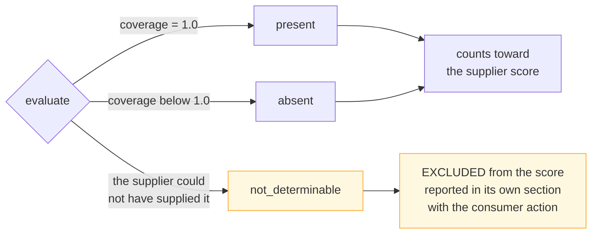
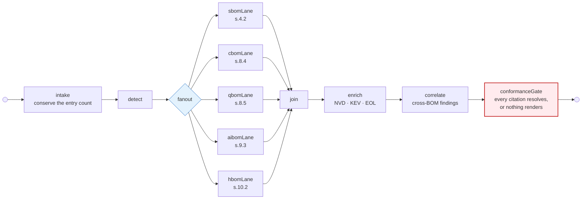

# BOM Automation

**CERT-In conformance and attestation platform.** It receives a supplier's Bill of
Materials, scores all five BOM types against the CERT-In minimum elements, correlates them
against each other, and issues an assessment with a clause reference behind every figure.

Source of truth for every clause reference: *CERT-In Technical Guidelines on SBOM, QBOM &
CBOM, AIBOM and HBOM*, **v2.0, 09.07.2025**.

| | |
|---|---|
| **Minimum elements encoded** | 82 across five lanes — SBOM 21 · CBOM 20 · AIBOM 16 · HBOM 15 · QBOM 10 |
| **Tests** | 806 backend · 36 frontend · ruff, mypy and `tsc` clean |
| **Scale** | 50,000 components in **~5 s**, ~210 MB peak — `make scale` |
| **Clause provenance** | 26 of 101 references confirmed — the rest labelled provisional |
| **Our own conformance** | **38.21%, fail** — published anyway |

```bash
make demo     # the whole stack on SQLite. No Docker, no Postgres, no Redis.
```

---

## The problem this is built around

A supplier sends a CycloneDX file. Somebody has to decide whether it meets the guideline.
By hand, across four hundred components and twenty-one minimum elements, that takes days,
gives different answers depending on who does it, and cannot be defended in an audit six
months later when nobody remembers why a field was accepted.

The failure this whole design is organised against is narrower than "being wrong". It is
being **wrong in the client's favour** — a green tick on a field nobody checked, a score of
92% over the eleven components whose licences happened to be readable, a `not_determinable`
field counted as compliant because it was easier. Each of those produces a client who fails
a real audit while holding our assessment.

### Three verdicts, not two

Most conformance tools have two states, and that is the root of it.



Criticality (s.4.2(12)) is relative to the *consuming deployment*. Usage Restrictions
(s.4.2(13)) is a legal determination. Intended and Out-of-Scope Usage (s.9.3(15)–(16)) are
governance declarations. **A supplier could not have supplied any of them.** Scoring them
as defects produces a report a supplier can discredit; scoring them as compliant puts a
green tick on a field nobody checked. Seven of the eighty-two elements are excluded from
the supplier score entirely, and each names the action the consuming organisation must take.

---

## What it does



All five lanes run on every assessment, with independent failure and timeout. **A lane that
is absent, disabled or times out is a reported finding, never a crashed assessment.**

| Lane | Clause | Elements | Accepts |
|---|---|---:|---|
| SBOM | s.4.2 | 21 | CycloneDX JSON/XML, SPDX JSON, SPDX tag-value |
| CBOM | s.8.4 | 20 | CycloneDX 1.6 cryptographic assets — algorithms, keys, protocols, certificates |
| QBOM | s.8.5 | 10 | CycloneDX 1.6 |
| AIBOM | s.9.3 | 16 | CycloneDX 1.6 model cards |
| HBOM | s.10.2 | 15 | CSV/XLSX asset register **or** CycloneDX `type: device` |

**None of these tables was ever approximated.** Each lane stayed empty — and therefore
reported `lane_absent` — until its table was actually encoded, because a guessed table
produces a confident score against invented clauses.

### Findings no single-lane tool can produce

| Rule | Clause | Finding |
|---|---|---|
| `cryptoInSbom` | s.8.4.1.2 | OpenSSL in the SBOM with no CBOM declaring assets |
| `modelDepsInSbom` | s.9.3(6) | The AIBOM names `torch`; the SBOM does not — the SBOM is incomplete |
| `algorithmQuantumExposure` | s.8.5.1 | RSA or ECC declared with no PQC migration path |
| `firmwareInHbom` | s.10.2.4 | Declared firmware with no SBOM coverage |

A single-lane submission produces **zero** correlation findings. A client with only an SBOM
has not failed to declare their cryptography — they were never asked to. A rule whose lanes
are absent is reported as `skipped` **with the lane that was missing**, because "did not
run" and "found nothing" are different answers.

---

## Run the demo

```bash
make demo      # SQLite, inline jobs, MFA off. No Docker, no Postgres, no Redis.
```

Console at `http://localhost:5173`. Sign in as `assessor@firm-a.example` /
`demo-password-1234` — a **manager**, so the review gate is exercisable.

The seeded engagement enables four lanes and carries real documents: a **76-component
cdxgen SBOM** of an actual project, an AIBOM with 2 models, a CBOM with 6 cryptographic
assets, and a 4-row asset register for HBOM. QBOM is left disabled, so it reports
`lane_not_applicable` rather than `lane_absent` — the distinction that decides whether a
client is being told "you had nothing to declare" or "you failed to declare it".

Drill from the five-lane strip into s.4.2(5) and its clause reference. The score is a real
score over a real document.

---

## Documentation

| Document | Read it for |
|---|---|
| [Product specification](docs/PRODUCT_SPECIFICATION.md) | The verdict model, scoring, roles, workflows, quotas, API surface, limitations |
| [Architecture](docs/ARCHITECTURE.md) | Context, containers, the graph, tenancy, observability — 15 diagrams |
| [Data model](docs/DATA_MODEL.md) | 28 tables, ER diagrams, every index and the rule it carries |
| [Compliance matrix](docs/COMPLIANCE_MATRIX.md) | Every implemented clause, where it lives, and its provenance |
| [SECURITY.md](SECURITY.md) | Disclosure route, the four VEX statuses, our dependency-adoption policy |

---

## The rules that are not preferences

Read §11 of the specification before changing `services/score/`, `services/catalogue/` or
`validators/`. These are enforced in code and asserted by tests, not stated as guidance.

- **The LLM never produces a verdict, a figure or a clause reference.** Those come from the
  scoring engine and the catalogue. A citation that does not resolve to the pinned guideline
  version stops the render — and there is **no bypass flag**, because a flag would
  eventually be used by someone under deadline.
- **`not_determinable` is never `compliant`.** Excluded from the supplier score, reported
  separately, paired with the consumer action.
- **Partial coverage is not a pass.** Licences on 12 of 400 components has not met s.4.2(5).
- **Nothing is dropped silently.** parsed + rejected equals the input entry count, asserted
  per document, with every rejection carrying an actionable reason.
- **An unrecognised format raises.** It never returns an empty component list, because an
  empty list renders a green assessment of a supplier who submitted something unreadable.
- **`lane_not_applicable` ≠ `lane_absent`.** The first is excluded from the overall score;
  the second is a finding.
- **A critical gap fails at any score.** A BOM with no versions can score respectably on
  descriptive fields while being useless for every purpose the guideline exists to serve.
- **Agents research; they never decide.** Every agentic output is a proposal carrying
  evidence, confidence and hop count, queued for human confirmation.
- **Tenancy is enforced at the repository layer, never the router.** A new endpoint is one
  forgotten `WHERE` clause away from leaking, and the omission looks like nothing at review.

---

## We ship what we ask for

This repository publishes its own SBOM, AIBOM, CBOM, VEX advisories, maturity scorecard and
catalogue audit per release, scored by its own engine — whatever the numbers say.

```
self-conformance: 38.21% (fail) over 906 components
  fails on critical gap(s): 4.2(4) Supplier Name, 4.2(21) CERT-In Unique Identifier
```

| Published to `dist/` | Contents |
|---|---|
| `bom-automation.cdx.json` | Our own SBOM, regenerated per release per s.2.3 |
| `bom-automation.aibom.cdx.json` · `.cbom.cdx.json` | Our own AIBOM and CBOM |
| `maturity-scorecard.json` | Our s.3.3 position: **below start** |
| `catalogue-audit.md` | All 101 clause references with provenance: **26 confirmed** |
| `scale-report.md` | Measured performance, per lane |
| `vex/` | A real CSAF advisory for a real CVE in one of our dependencies |

A firm that assessed clients while hiding its own scorecard would deserve the obvious
question. s.4.2(4) and s.4.2(21) fail because the supplier registry holds no curated entry
for most of our dependencies — an honest gap, published rather than suppressed.

---

## Quick start

```bash
make install                                   # uv sync + yarn install
cp backend/.env.example backend/.env.local     # three required keys
make dev                                       # postgres + redis + API + Vite
```

`make dev` needs Docker for Postgres and Redis. Without it, `make demo` runs the whole stack
on SQLite, and `make dev-api` / `make dev-web` run each app alone.

| Command | What it does |
|---|---|
| `make test` | pytest + vitest |
| `make lint` · `make typecheck` | ruff + eslint · mypy + tsc |
| `make self-bom` | CycloneDX SBOM of this repository into `dist/` |
| `make scale` | The 50,000-component budget and per-lane p95 |
| `make catalogue-audit` | Every clause reference with its provenance |
| `make help` | every target |

---

## Engineering notes

### Parallelism, measured rather than assumed

The five lanes genuinely overlap in wall-clock time, and
`AssessmentSummary.parallelism_proven` asserts it from the `node_runs` intervals. But
scoring is pure Python and holds the GIL, so **concurrency here buys isolation, not
throughput** — 4,000 components + 3,000 models took 173 ms and 124 ms alone, 263 ms back to
back, 281 ms through the fan-out.

That is the right trade, and it is recorded in `graph/laneRunner.py` rather than left to be
discovered under load. What the fan-out is actually for is that a hung or crashed lane
cannot take the other four with it. Reporting the overlap as a performance win would be
exactly the kind of unfounded figure the first rule above exists to prevent.

At scale: 50,000 components in **about five seconds** and ~210 MB, against a stated budget
of 30 s and 1 GB. The exact figure moves with the machine, so the prose gives the order of
magnitude and `dist/scale-report.md` carries the measurement. The budget is loose on purpose — one set *at* the measurement fails on a slow CI
runner, gets called flaky, and gets deleted. What the tests actually guard is **linearity**,
because a wall-clock budget catches a slow machine and not an accidental O(n²).

### Testing the database layer without a database

The models are deliberately dialect-portable, so repository logic runs on SQLite via
`aiosqlite` and the tenancy guards are exercised on every push. The migration is validated
by rendering it through Alembic's **offline mode** and diffing against the model metadata —
schema drift is caught in CI with no Postgres at all.

What that cannot cover is stated at the foot of `tests/test_repositories.py`: real
`text[]`/`JSONB`/native enums, the genuinely partial index, and concurrent writers actually
racing the guard.

### Reconstructing an assessment from logs alone

One `submission_id` rebuilds all five lane lifecycles — including the lanes that did
nothing, which are precisely the lanes a client later asks about and precisely the ones that
would otherwise never appear in the logs. Correlation is bound once per assessment and
inherited by the lane threads, because threading identifiers through call signatures works
until the first place somebody forgets.

---

## Layout

```
backend/          FastAPI + LangGraph      mirrors ai-chat-be
frontend/         Vite + React 19 + TS     mirrors etl-student-frontend
packages/         generated API types
docs/             specification, architecture, data model, compliance matrix
dist/             our own BOMs, VEX, scorecards and audits per release
```

`backend/app` carries the nine house directories plus `workers/`. Route handlers stay under
15 lines and contain no SQL; an AST test fails the build otherwise. No module in
`services/graph/` exceeds 200 lines, and `builder.py` contains zero prompt text.

---

## Known limitations

Stated plainly. A conformance tool that overstates its own scope is the first thing a real
auditor tests.

- **Catalogue provenance is 25.7% confirmed.** 75 of 101 clause references are provisional.
  The audit that resolves them is a person reading the published PDF; the instrument
  produces the worksheet and states plainly that it **cannot perform the audit itself**.
- **Org-scoped retrieval over past assessments is not built.** The specification calls for
  pgvector plus hybrid search over the firm's own prior assessments, policies and house
  remediation wording — scoped per org and never across clients — feeding *narrative wording
  only*. Neither it nor the narrative-drafting path it was meant to feed exists: there are no
  drafter nodes, `services/graph/prompts/` is empty, and the three `narrative_*` job types are
  declared in the enum and wired to nothing.
- **Frontend XSS rests on React's default escaping and is not asserted by a test.** There is
  no `dangerouslySetInnerHTML` anywhere in `frontend/src`, which is the real protection, but
  component names are supplier-controlled text and that property deserves a test rather than
  a grep.
- **The repo sandbox has not been re-tested against a hostile build script.** It refuses when
  isolation is unavailable, and that refusal is tested; an adversarial `postinstall` payload
  proving the container boundary holds is not.
- **`vexCoverage` correlation is not live** — reported as pending with its reason, never
  silently absent.
- **No Playwright end-to-end suite.** The critical path is covered by API-level and
  component tests.
- **Rate limiting is per process**, so two API instances allow twice the configured rate.
  The limit exists to stop a runaway client script, and per-process is enough for that.
- **Repository generation needs a container runtime.** Without network isolation it refuses
  rather than degrading — dependency resolution executes the repository's own build scripts.
- **No language model is wired in.** The verdict path never needed one. Where a model would
  legitimately help — messy field mapping, web research, narrative wording — the slots exist
  and are unfilled.
- **Human gates remain open**: counsel has not signed off the generated procurement clause,
  a cryptography practitioner has not reviewed a full CBOM assessment, the catalogue
  re-derivation is outstanding, and no pilot cohort has run. Each is a gate the
  specification places on the work, and none can be satisfied by code.
