# BOM Automation — Architecture

**One repository, two applications, five assessment lanes, one tenant boundary.**

Conformance basis: *CERT-In Technical Guidelines on SBOM, QBOM & CBOM, AIBOM and HBOM*,
**v2.0, 09.07.2025**.

Companion documents: [PRODUCT_SPECIFICATION.md](PRODUCT_SPECIFICATION.md) ·
[DATA_MODEL.md](DATA_MODEL.md) · [COMPLIANCE_MATRIX.md](COMPLIANCE_MATRIX.md)

---

## 1. System context

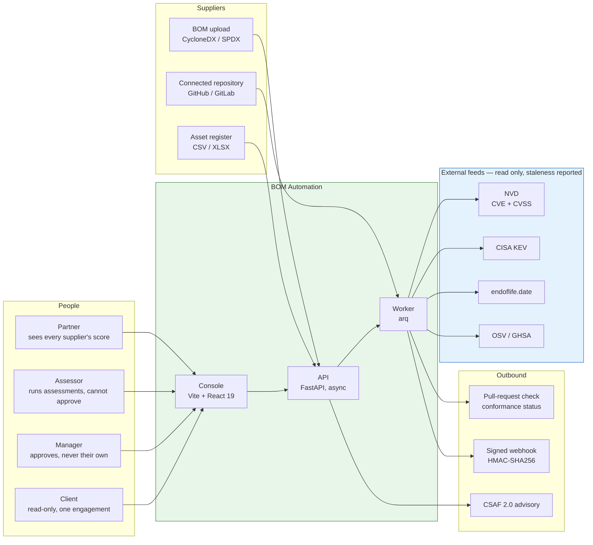

The product is built **consumer-side**: a client *receiving* BOMs wants conformance
scoring, supplier chasing and gap reports. A vendor *shipping* to government wants
generation, identifier mapping and VEX maintenance. Same guideline, opposite products.
This one assesses, and generation exists only because assessing a supplier's SBOM against
one we generated from their repository is the strongest finding the tool can produce.

---

## 2. Containers

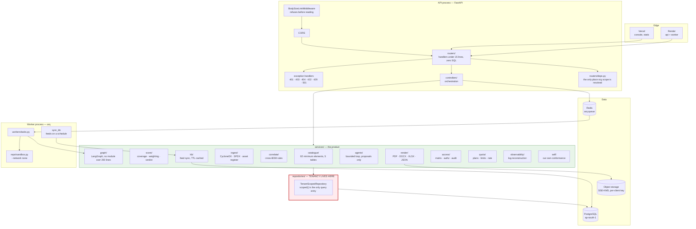

**Why tenancy is red.** A BOM is an architecture disclosure and this system holds many
suppliers' at once, so cross-tenant reachability is the failure that ends the product.
Routers are the wrong place to enforce it: a new endpoint is one forgotten `WHERE` clause
away from leaking, and the omission looks like nothing at review. So every repository is
constructed *with* an org scope, `scoped()` is the only method that builds a query, and a
test parses the repository package's AST to fail the build if any method constructs a bare
`select(self.model)`.

---

## 3. The assessment graph

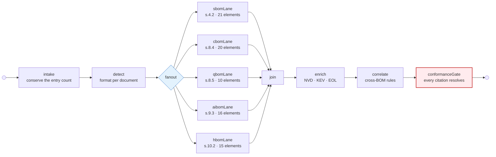

**All five lane nodes are edged in unconditionally.** A lane the engagement did not enable
reports `lane_not_applicable` from *inside* the node. Skipping the edge instead would make
"not applicable" indistinguishable from "nobody ran it" — and those are the two answers a
client most needs told apart.

**`enrich` sits between `join` and `correlate`, not after it.** The feeds populate the KEV
data that the `vexCoverage` rule reads; correlating first would evaluate that rule against
entities whose vulnerabilities had not been looked up yet, and report a clean result.

**Layout constraint.** No module in `services/graph/` exceeds 200 lines and `builder.py`
contains zero prompt text. Prompts are data, one module per node, under `graph/prompts/`.

### What each lane node actually does

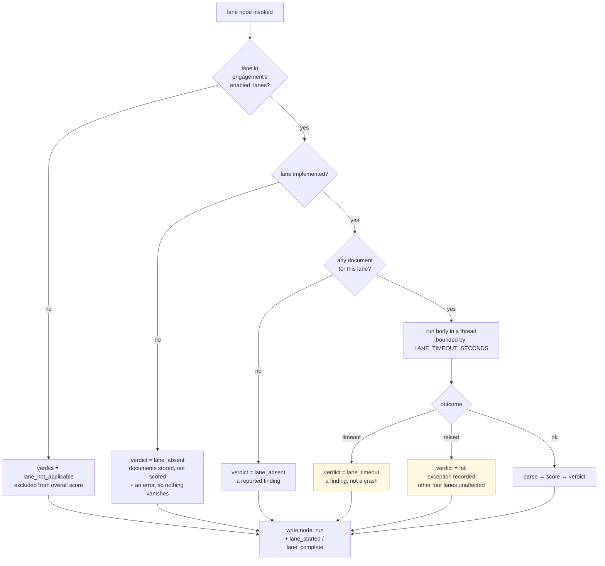

**Lanes fail independently.** An absent or timed-out lane is a *reported finding*, never a
crashed assessment. A client who submitted five documents and gets an HTTP 500 learns
nothing; a client who gets four lane verdicts and "CBOM exceeded its 120-second budget"
knows exactly where they stand.

**On what the fan-out actually buys.** The lanes run through `asyncio.to_thread` and their
intervals genuinely overlap, which is what the isolation above depends on. It is **not** a
speedup: scoring is pure Python and holds the GIL, so five lanes over one document cost
about what five sequential lanes cost, plus scheduling. Measured figures are in
`dist/scale-report.md`; the measurement that established it is recorded in
`services/graph/laneRunner.py`.

---

## 4. Scoring pipeline

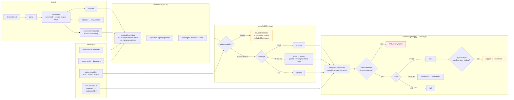

Four rules in that diagram are the product rather than preferences:

1. **Partial coverage is not a pass.** Licences on 12 of 400 components has not met
   s.4.2(5). The field verdict is `absent` and the coverage ratio is reported beside it.
2. **Out-of-scope assets leave the denominator.** A classical security level is meaningful
   for an algorithm and meaningless for a certificate. Counting certificates as *absent* on
   algorithm fields would make the score measure document composition rather than
   declaration quality; counting them as *populated* would inflate it. They are excluded.
3. **A critical gap fails at any score.** A BOM with no versions can score respectably on
   descriptive fields while being useless for every purpose the guideline exists to serve.
4. **A configuration finding caps the verdict.** Coverage measures whether a supplier
   *declared* their cryptography; it cannot see that what they declared is an expired
   certificate, TLS 1.0 and 3DES. A lane reporting `pass` on that document would be
   complete, arithmetically correct, and wrong in the client's favour.

---

## 5. Cross-BOM correlation

The class of finding no single-lane tool can produce.

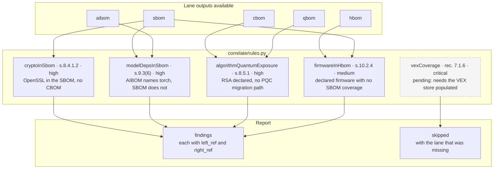

**A rule whose lanes are absent is `skipped`, never silently passed.** "Did not run" and
"found nothing" are different answers, and a single-lane submission produces **zero**
correlation findings — a client with only an SBOM has not failed to declare their
cryptography, they were never asked to. Correlating against nothing is invention.

Correlation findings cite the guideline exactly as field verdicts do, so they pass the same
conformance gate. Otherwise the one class of finding no other tool can produce would be the
one class nobody verified.

---

## 5a. Retrieval-augmented drafting

The one place a language model enters this system, and the boundary that keeps §11
true across it.

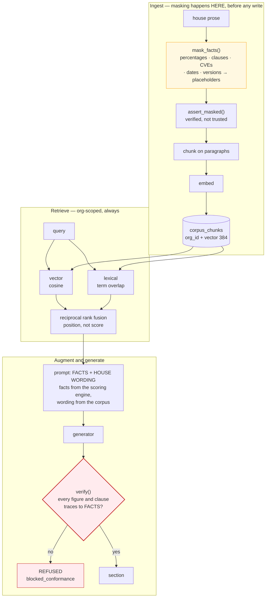

**Facts are masked on the way *in*, not on the way out.** A figure that never
entered the corpus cannot be retrieved by a future code path that forgets to mask,
cannot be reached by a manipulated query, and cannot survive a database dump into
somewhere less careful. What is stored is the sentence shape — which is the entire
reason to retrieve house wording:

```
"Licences were absent across 388 of 412 components, failing 4.2(5)."
→ "Licences were absent across ⟨count⟩ of ⟨count⟩ components, failing ⟨clause⟩."
```

**Fusion reads position, not score.** Cosine similarity sits around 0.2–0.4 for
related prose; term overlap is a fraction that frequently saturates at exactly 1.0.
Adding or averaging those two scales does not combine two opinions — it lets
lexical dominate whenever it saturates. RRF gives each retriever an equal vote.

**`verify()` is the boundary, and it checks provenance rather than resolution.**
The conformance gate downstream confirms that a clause reference *resolves*; a
fabricated `4.2(4)` resolves perfectly, because it is a real clause. So every
figure and clause in a generated draft is checked against the facts that were
supplied, and an unsupported one is a refusal — the job goes to
`blocked_conformance` and is **not retried**, because re-running the same prompt
against the same model produces the same class of fabrication and eventually ships
one.

**Tenancy is the property this component lives or dies on.** Every other table
answers questions about one client; this one exists to surface passages written for
*other* engagements, and only the org scope separates "another engagement of ours"
from "a competitor's". `tests/test_retrieval.py` seeds the other tenant with the
**best possible match** for the query, so a missing predicate surfaces as the first
result rather than hiding in a tail.

---

## 6. Request lifecycle and where each rule is enforced

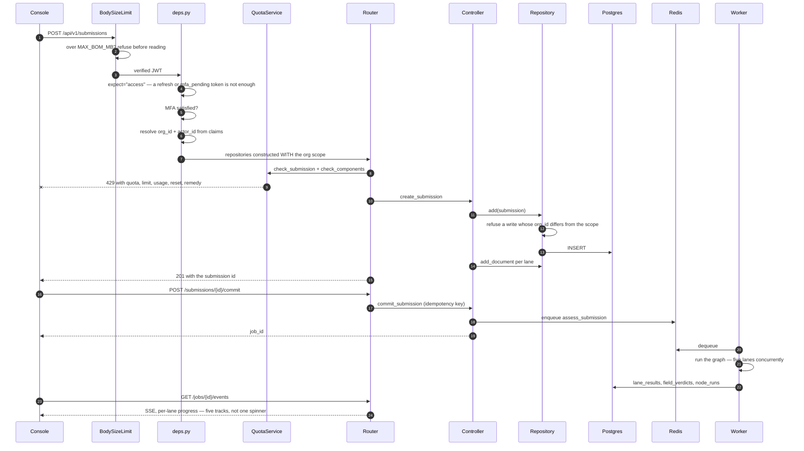

---

## 7. Tenancy: the four denied paths

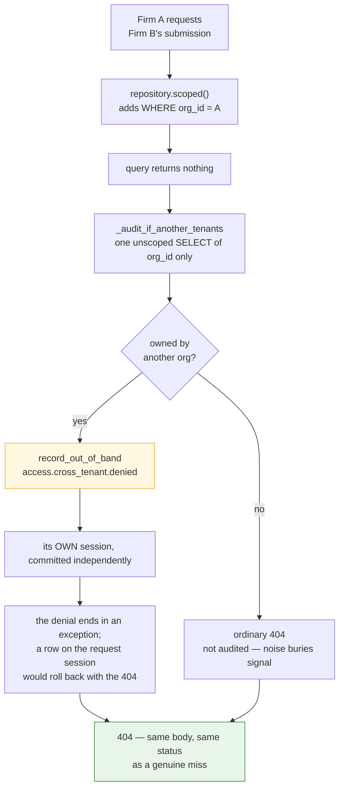

All four access paths are denied and tested: **read, list, search-by-checksum, and
download**. All four return **404, not 403** — a 403 would confirm the resource exists, and
so would the word "forbidden" anywhere in the body.

403 is correct in exactly one place: a caller inside their own org whose *role* does not
permit the action. There, acknowledging the resource leaks nothing.

### The authorization matrix

```mermaid
graph LR
    subgraph roles["5 roles"]
        P[partner]
        M[manager]
        A[assessor]
        RO[readonly]
        CL[client]
    end
    subgraph res["11 resources"]
        R1[submission]
        R2[assessment]
        R3[lane_result]
        R4[vex_statement]
        R5[identifier_mapping]
        R6[supplier_registry]
        R7[engagement]
        R8[user]
        R9[audit_event]
        R10[maturity]
        R11[repository]
    end
    subgraph acts["7 actions"]
        A1[read]
        A2[list]
        A3[create]
        A4[update]
        A5[delete]
        A6[approve]
        A7[export]
    end
    roles --> res --> acts
```

**55 cells, every one decided.** `missing_cells()` must return empty, so adding a resource
forces a decision about who may reach it rather than inheriting whatever the first endpoint
allowed. The matrix is closed — an unlisted pairing is denied, never permitted by default.

Four invariants are asserted over the whole table:

- Only `partner` may **delete** anything. Deletion is the one action with no undo.
- No role may **write** the audit trail. An audit trail the application can edit is not one.
- **read implies list.** Denied listing plus permitted reads is an enumeration oracle: a
  caller learns what exists from the difference between the two answers.
- No role may **update what it cannot read**.

The role predicates in `authz.py` read this table rather than restating it, and an AST test
fails the build if one grows a second copy of a role list.

---

## 8. Repository ingestion and generation

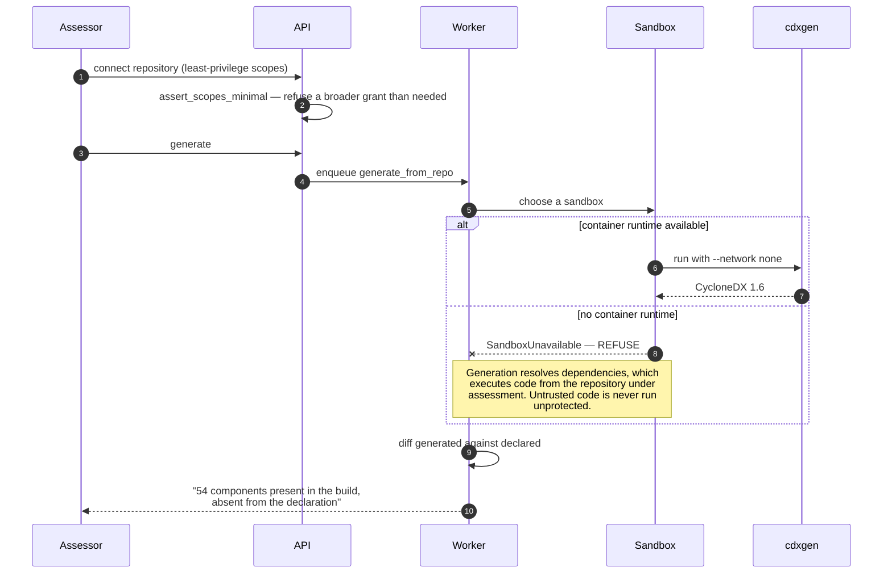

**`LocalSandbox` refuses untrusted work rather than degrading.** Dependency resolution runs
the repository's own build scripts. Without network isolation, a hostile `package.json`
`postinstall` reaches our infrastructure. A fallback that "just runs it locally" is exactly
how that becomes a breach, so the honest failure mode is a refusal that names the reason.

---

## 9. The CI conformance gate

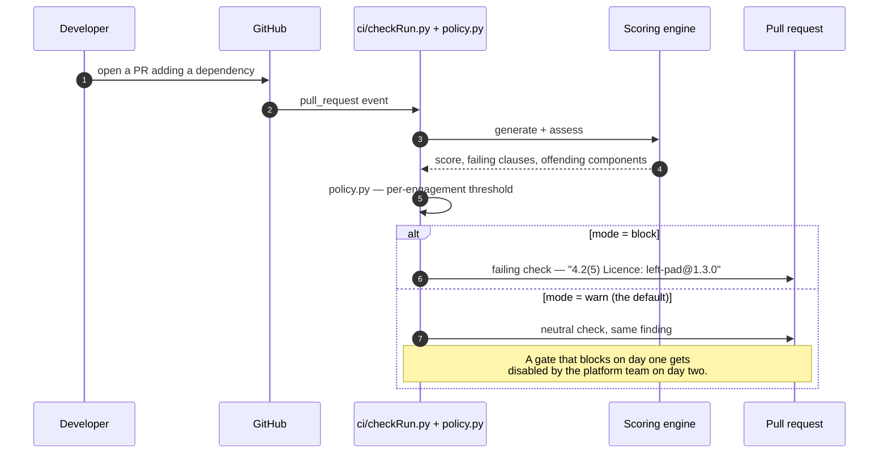

**This repository is the first one connected.** The gate runs against our own pull requests
before any client sees it, and our own conformance score is published whatever it says.

---

## 10. Observability

```mermaid
flowchart LR
    subgraph bind["assessment_context — bound once"]
        B1[submission_id]
        B2[job_id]
        B3[org_id]
    end

    subgraph emit["Every lane, whatever it did"]
        E1[lane_started]
        E2["lane_complete<br/>verdict · entity_count · latency_ms"]
        E3["lane_failed<br/>then still completes"]
    end

    subgraph proc["structlog processors"]
        P1[merge_contextvars]
        P2[add_log_level]
        P3[TimeStamper]
        P4["redaction_processor<br/>LAST before rendering"]
        P5[JSONRenderer]
    end

    subgraph rebuild["observability/trace.py"]
        R1["reconstruct(lines, submission_id)"]
        R2["5 LaneLifecycle objects"]
        R3["missing · incomplete · whole"]
        R4["latency_percentiles — per lane"]
    end

    bind --> emit --> proc --> R1 --> R2 --> R3
    R2 --> R4

    style P4 fill:#ffebee,stroke:#c62828
```

**One `submission_id` reconstructs all five lane lifecycles.** Read literally, that is the
hard version: the lane that was disabled or received no document does no work, has nothing
interesting to say, and is therefore exactly the lane that gets left out of the logs — and
exactly the lane a client asks about. So `lane_started` is emitted before any branch.

Correlation comes from `structlog.contextvars`, bound once per assessment and inherited by
the lane threads because `asyncio.to_thread` copies the context. Threading the identifiers
through call signatures would work until the first place somebody forgot, and that place is
the one somebody would eventually ask about.

`started-but-never-ended` stays distinguishable from `never-reached`. A hung lane and an
unreached lane are different incidents.

**Redaction runs last**, so nothing a later processor adds escapes it. Logs outlive
engagements.

---

## 11. Quotas

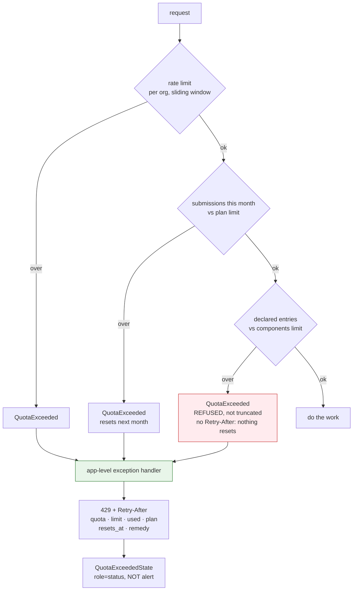

**The handler is registered on the app, not per route.** That is what makes "never a 500"
hold: a `QuotaExceeded` raised from a service the route never expected would otherwise
surface as a 500 — precisely the failure the requirement names.

**Component overage is refused, not truncated.** Scoring the first 5,000 components of a
40,000-component estate would produce a figure that looks complete and describes an eighth
of the software — the partial-coverage failure, arriving through the billing system.

**The UI renders it as a status, not an alert.** The request was valid and the service is
healthy. Styling a billing limit as an outage teaches clients to read it as one.

---

## 12. Frontend structure

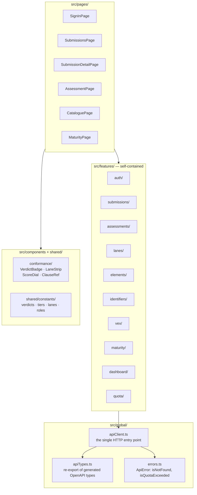

Each feature is self-contained: `components/ hooks/ services/ store.ts types.ts index.ts`.
Server state is TanStack Query; client state is Zustand — server state is not client state.

**API types are generated, never hand-written.** `packages/api-types/` is produced from the
backend's OpenAPI schema and CI fails if it is stale, so a backend shape change cannot
reach the console as a runtime surprise.

Three presentation rules the console enforces:

- **Null is an em dash, never `0%`.** An unscored submission and a zero-scoring one look
  completely different to a reader, and only one of them is a catastrophe.
- **A 404 means "not found", never "no access."** Tenancy returns 404 so existence does not
  leak; a console that renders "you lack permission" leaks exactly what the 404 protects.
- **Attested must never look like evidenced.** The maturity view styles an attested verdict
  with a dashed border and italics, because a scorecard where a client's word and a checked
  artifact render identically is a scorecard that invites a client to trust the wrong half.

---

## 13. Deployment

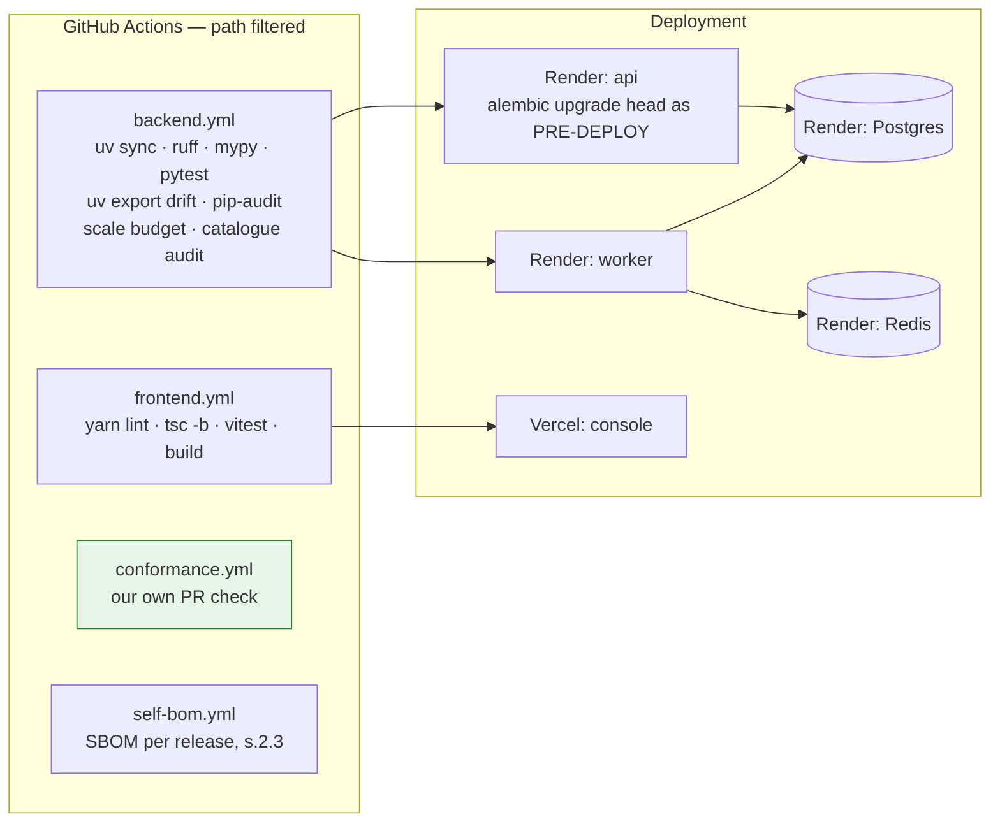

**`alembic upgrade head` is a pre-deploy step, not an app-startup hook.** A migration that
runs at startup runs once per instance, concurrently, on a rolling deploy.

**Path filtering is a stated requirement, not an optimisation.** A pull request touching
only `frontend/` must not run the backend suite — a CI that always runs everything is a CI
people learn to ignore.

**`pip-audit --strict` is blocking.** A supply-chain conformance tool shipping
known-vulnerable dependencies is not commercially survivable.

**`scale` is blocking too.** The failure it catches is algorithmic: a per-component cost
that quietly became quadratic passes every functional test and turns a client's
50,000-component estate into a timeout.

---

## 14. Measured performance

From `dist/scale-report.md`, regenerated by `make scale`:

| Measurement | Figure |
|---|---|
| 50,000-component SBOM, wall clock | **~5 s** (~4 s CPU) |
| Peak RSS for that document | **~210 MB** |
| Per component | ~0.1 ms |
| Stated budget | 30 s / 1024 MB — loose on purpose |
| 20 concurrent five-lane assessments | ~4 s total |
| Throughput | ~12,000 components/second |
| Lane intervals overlap | yes |
| Every submission reconstructable from logs | yes |

The budget is four times the measurement deliberately. A budget set *at* the measurement
fails on a slow CI runner, gets called flaky, and gets deleted. What the tests actually
guard is **linearity** — a wall-clock budget catches a slow machine, not an accidental
O(n²).

Concurrency **shares** throughput rather than adding to it. What it buys is that no client
waits behind another client's whole queue, not that the machine does more work. Repository
generation is reported separately because it takes minutes rather than seconds.

---

*See [PRODUCT_SPECIFICATION.md](PRODUCT_SPECIFICATION.md) for the functional specification,
[DATA_MODEL.md](DATA_MODEL.md) for the schema, and
[COMPLIANCE_MATRIX.md](COMPLIANCE_MATRIX.md) for the clause-by-clause mapping.*
