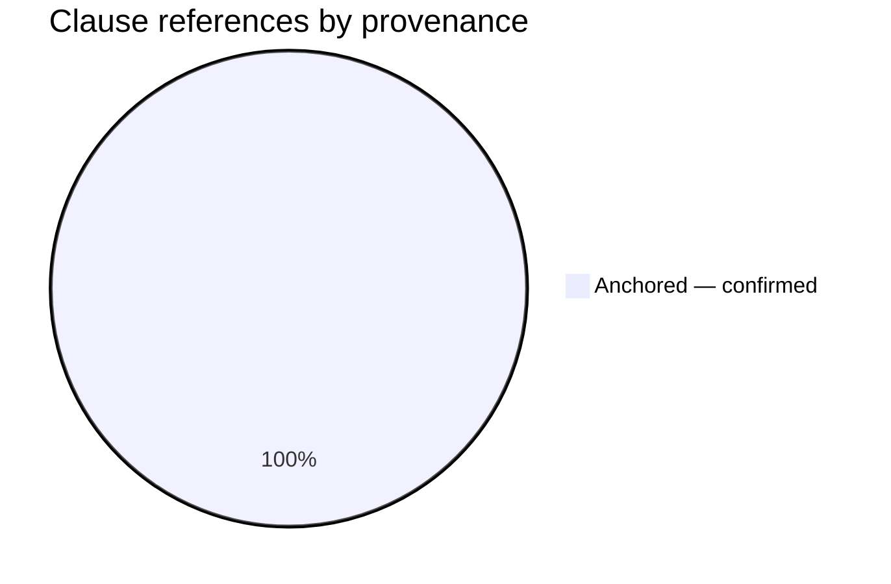
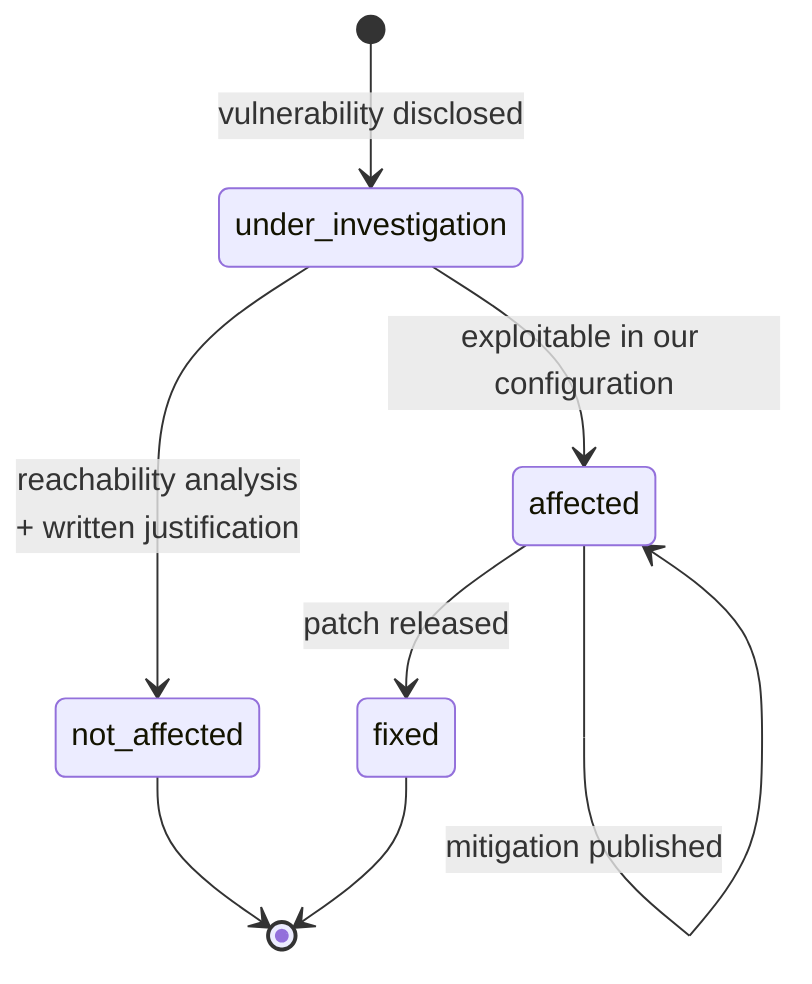
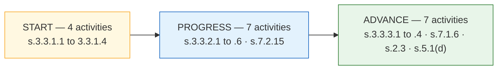

# BOM Automation — CERT-In Compliance Matrix

Every clause of the *CERT-In Technical Guidelines on SBOM, QBOM & CBOM, AIBOM and HBOM*,
**v2.0, 09.07.2025** that this product implements, and exactly where it is implemented.

**Read the provenance column before quoting any clause number.** 124 of 124 clause
references in this product are **anchored**: each was checked against the published text of the
guideline. **All five BOM lanes and the s.3.3 roadmap have now been checked against the PDF.** That
check found that the earlier tables differed from the guideline's (missing elements, elements the
guideline does not list, invented clause numbers, and numbers pointing at the wrong section, which
included roadmap clauses that belonged to other activities); each was corrected, and
`tests/test_guideline_fidelity.py` now compares every lane and the roadmap with the guideline's own
list. "Anchored" means checked against the text of the guideline, not signed off by a reviewer: the
reviews the specification lists as open (counsel, and a cryptography practitioner) have not
happened. The number is published as it stands, in `dist/catalogue-audit.md` and regenerated by
`make catalogue-audit`, because a provisional
ordinal presented as confirmed is the single defect that would discredit every assessment
this firm issues.



| Source | Confirmed | Total | % |
|---|---:|---:|---:|
| SBOM (s.4.2) | 21 | 21 | 100.0% |
| AIBOM (s.9.3, Table 10) | 19 | 19 | 100.0% |
| CBOM (s.8.3, Table 9) | 30 | 30 | 100.0% |
| QBOM (s.8.3, Table 8) | 11 | 11 | 100.0% |
| HBOM (s.10.3, Table 11) | 20 | 20 | 100.0% |
| Correlation rules | 5 | 5 | 100.0% |
| SSDLC roadmap (s.3.3, s.2.3, s.5.1(d), s.7.1.6, s.7.2.15) | 18 | 18 | 100.0% |
| **Total** | **124** | **124** | **100.0%** |

Correlation rules are fully anchored because the specification names those section numbers
in prose rather than leaving them to be counted off a table — which is precisely what made
the lane ordinals provisional. (Table 8 to 11 carry no ordinals at all; those lanes now cite
elements by section, table and name.)

---

## 1. SBOM — s.4.2, twenty-one minimum elements

| Clause | Element | Tier | Determinability | Scope | Provenance |
|---|---|---|---|---|---|
| 4.2(1) | Component Name | critical | auto | entity | **anchored** |
| 4.2(2) | Version of the Component | critical | auto | entity | **anchored** |
| 4.2(3) | Component Description | contextual | auto | entity | **anchored** |
| 4.2(4) | Supplier Name | critical | auto | entity | **anchored** |
| 4.2(5) | Licence | critical | auto | entity | **anchored** |
| 4.2(6) | Origin / Source Repository | standard | auto | entity | **anchored** |
| 4.2(7) | Dependencies | critical | auto | entity | **anchored** |
| 4.2(8) | Known Unknowns / Vulnerabilities | standard | enrich | entity | **anchored** |
| 4.2(9) | Patch Status | standard | enrich | entity | **anchored** |
| 4.2(10) | Release Date | standard | enrich | entity | **anchored** |
| 4.2(11) | End-of-Life Date | standard | enrich | entity | **anchored** |
| 4.2(12) | Criticality | contextual | **human** | entity | **anchored** |
| 4.2(13) | Usage Restrictions | contextual | **human** | entity | **anchored** |
| 4.2(14) | Cryptographic Hash of the Component | standard | auto | entity | **anchored** |
| 4.2(15) | Comments or Notes | contextual | auto | entity | **anchored** |
| 4.2(16) | Author / Originator Name | standard | auto | **document** | **anchored** |
| 4.2(17) | Timestamp | standard | auto | **document** | **anchored** |
| 4.2(18) | Executable Property | contextual | auto | entity | **anchored** |
| 4.2(19) | Archive Property | contextual | auto | entity | **anchored** |
| 4.2(20) | Structured Property | contextual | auto | entity | **anchored** |
| 4.2(21) | CERT-In Unique Identifier | critical | auto | entity | **anchored** |

Implementation: `backend/app/services/catalogue/sbom.py` ·
lane `backend/app/services/graph/nodes/sbomLane.py`

**4.2(12) and 4.2(13) are consumer determinations.** Criticality is relative to the
*consuming deployment*; Usage Restrictions is a legal determination. A supplier could not
have supplied either. Both are excluded from the supplier score, reported in their own
section, and each carries the consumer action that resolves it.

**4.2(16) and 4.2(17) are document-scoped.** They are properties of the BOM, not of each
component. Probing per component reported them absent across every entity — telling a
supplier they failed a clause they demonstrably met, hidden completely by the weighted
score because 0/855 looks exactly like a genuine gap. Fixing it moved a real
cdxgen-generated document from 28.53% to 38.28% at the time it was measured — the
current figure moves with our dependency set and is regenerated by `make self-boms`.

**4.2(21) is the Table 3 identifier**, formed as
`pkg:supplier/OrganizationName/Component@Version`. It is emitted only when the supplier
organisation resolves from the curated registry or a human-confirmed proposal; otherwise
the field is `not_determinable` with the resolution action, because a plausible-looking
wrong identifier is worse than an admitted absence.

---

## 2. CBOM — s.8.3, Table 9, four asset types

Table 9 lists thirty rows by name, grouped by cryptographic asset type, and numbers none of them, so
each is cited by section, table, group and name, in the order the table gives them. All thirty
are anchored: read from the PDF and checked against its page images. (The earlier catalogue cited
s.8.4.1.2 to s.8.4.4.1, which are the guideline's recommendations and not its minimum elements.)

| Clause | Element | Tier | Asset type | Provenance |
|---|---|---|---|---|
| 8.3 Table 9: Algorithms - Name | Name | critical | algorithm | **anchored** |
| 8.3 Table 9: Algorithms - Asset Type | Asset Type | critical | algorithm | **anchored** |
| 8.3 Table 9: Algorithms - Primitive | Primitive | critical | algorithm | **anchored** |
| 8.3 Table 9: Algorithms - Mode | Mode | standard | algorithm | **anchored** |
| 8.3 Table 9: Algorithms - Crypto Functions | Crypto Functions | standard | algorithm | **anchored** |
| 8.3 Table 9: Algorithms - Classical security level | Classical security level | critical | algorithm | **anchored** |
| 8.3 Table 9: Algorithms - OID | OID | standard | algorithm | **anchored** |
| 8.3 Table 9: Algorithms - List | List | contextual | algorithm | **anchored** |
| 8.3 Table 9: Keys - Name | Name | standard | key | **anchored** |
| 8.3 Table 9: Keys - Asset Type | Asset Type | contextual | key | **anchored** |
| 8.3 Table 9: Keys - id | id | critical | key | **anchored** |
| 8.3 Table 9: Keys - state | state | standard | key | **anchored** |
| 8.3 Table 9: Keys - size | size | critical | key | **anchored** |
| 8.3 Table 9: Keys - Creation Date | Creation Date | standard | key | **anchored** |
| 8.3 Table 9: Keys - Activation Date | Activation Date | contextual | key | **anchored** |
| 8.3 Table 9: Protocols - Name | Name | standard | protocol | **anchored** |
| 8.3 Table 9: Protocols - Asset Type | Asset Type | contextual | protocol | **anchored** |
| 8.3 Table 9: Protocols - Version | Version | critical | protocol | **anchored** |
| 8.3 Table 9: Protocols - Cipher Suites | Cipher Suites | critical | protocol | **anchored** |
| 8.3 Table 9: Protocols - OID | OID | standard | protocol | **anchored** |
| 8.3 Table 9: Certificates - Name | Name | standard | certificate | **anchored** |
| 8.3 Table 9: Certificates - Asset Type | Asset Type | contextual | certificate | **anchored** |
| 8.3 Table 9: Certificates - Subject Name | Subject Name | critical | certificate | **anchored** |
| 8.3 Table 9: Certificates - Issuer Name | Issuer Name | critical | certificate | **anchored** |
| 8.3 Table 9: Certificates - Not Valid Before | Not Valid Before | standard | certificate | **anchored** |
| 8.3 Table 9: Certificates - Not Valid After | Not Valid After | critical | certificate | **anchored** |
| 8.3 Table 9: Certificates - Signature Algorithm Reference | Signature Algorithm Reference | standard | certificate | **anchored** |
| 8.3 Table 9: Certificates - Subject Public Key Reference | Subject Public Key Reference | standard | certificate | **anchored** |
| 8.3 Table 9: Certificates - Certificate Format | Certificate Format | contextual | certificate | **anchored** |
| 8.3 Table 9: Certificates - Certificate Extension | Certificate Extension | contextual | certificate | **anchored** |

Implementation: `backend/app/services/catalogue/cbom.py` ·
`backend/app/services/graph/nodes/cbomLane.py`

Seven elements are judgement calls, because the guideline gives each one sentence and no tier: the
algorithm List, and the Name and Asset Type rows of keys, protocols and certificates. An asset that
declares no type at all is counted once, under Algorithms - Asset Type, so a missing type is a gap
rather than being invisible.

**Asset-type scope changes the denominator, not the numerator.** A classical security level
is meaningful for an algorithm and meaningless for a certificate. Reporting a certificate as
missing its cipher mode is a category error, not a gap. Out-of-scope assets are excluded
from the denominator — counting them as absent would make the score measure document
composition rather than declaration quality, and counting them as populated would let a
document of ten certificates score 100% on every algorithm field.

### Configuration checks — Table 9, Protocols and Certificates

Declaration completeness and configuration acceptability are different measurements. These
read what was declared and judge it:

| Check | Clause | Severity | Detects |
|---|---|---|---|
| `certificateExpired` | 8.3 Table 9: Certificates - Not Valid After | high | A certificate past its `Not Valid After` date |
| `deprecatedProtocolVersion` | 8.3 Table 9: Protocols - Version | high | SSLv3, TLS 1.0, TLS 1.1 |
| `deprecatedCipherSuite` | 8.3 Table 9: Protocols - Cipher Suites | high | RC4, 3DES, NULL, EXPORT, anonymous suites |
| `weakCertificateSignature` | 8.3 Table 9: Certificates - Signature Algorithm Reference | high | SHA-1 or MD5 certificate signatures |

### The S20 security review, as tested

| Surface | Proven by |
|---|---|
| XXE in SPDX/CycloneDX XML | A live payload parsed; entity resolves to nothing. Asserted behaviourally — the earlier introspection check read an lxml attribute that does not exist and would have raised on a *safe* parser too |
| Formula injection on XLSX export | `=cmd\|'/c calc'!A1` and every `= + - @ \t \r` lead exported inert, through the real exporter |
| Zip bombs | Refused on the **measured** decompression ratio, not the declared size |
| Nested JSON | Refused beyond 40 levels, checked as it descends rather than by catching `RecursionError` |
| Frontend XSS | Six payloads through the components that render supplier text, asserted inert on the DOM; plus an AST guard over all of `src/` — a grep would match this documentation, which is a mistake the backend suite has made three times |
| Sandbox boundary | A hostile `postinstall` attempting credential harvesting, exfiltration, escape from the tree and outliving the run. A control case proves the payload succeeds *unprotected*, so a containment pass cannot be a broken fixture. Containment tests skip without a container runtime, with a stated reason; the argv guard runs everywhere |

Implementation: `backend/app/services/score/cryptoChecks.py`

**A high-severity configuration finding caps the lane verdict below `pass`.** Coverage
measures whether a supplier *declared* their cryptography; it cannot see that what they
declared is an expired certificate, TLS 1.0 and 3DES. A lane reporting `pass` on that
document would be complete, arithmetically correct, and wrong in the client's favour. The
finding does not zero the score — the assessment reports both measurements — but the
*verdict* may not claim the second when it measured the first.

---

## 3. QBOM — s.8.3, Table 8

Table 8 lists eleven rows by name and numbers none of them, so each is cited by section, table and
name, in the order the table gives them. All eleven are anchored. (The earlier catalogue cited
s.8.5.1 to s.8.5.10; s.8.5 is "Quantum-Readiness and Migration Strategy", a set of
recommendations, and the minimum elements are in s.8.3.)

| Clause | Element | Tier | Provenance |
|---|---|---|---|
| 8.3 Table 8: Model Name | Model Name | critical | **anchored** |
| 8.3 Table 8: Version | Version | critical | **anchored** |
| 8.3 Table 8: Vendor & Origin Information | Vendor & Origin Information | critical | **anchored** |
| 8.3 Table 8: License Information | License Information | standard | **anchored** |
| 8.3 Table 8: Cryptographic Asset | Cryptographic Asset | standard | **anchored** |
| 8.3 Table 8: Communication Protocol | Communication Protocol | standard | **anchored** |
| 8.3 Table 8: Hardware | Hardware | standard | **anchored** |
| 8.3 Table 8: Software Dependencies | Software Dependencies | standard | **anchored** |
| 8.3 Table 8: Environmental Impact | Environmental Impact | contextual | **anchored** |
| 8.3 Table 8: Vulnerabilities | Vulnerabilities | standard | **anchored** |
| 8.3 Table 8: Attestations | Attestations | standard | **anchored** |

Implementation: `backend/app/services/catalogue/qbom.py` ·
`backend/app/services/graph/nodes/qbomLane.py`

Four elements are judgement calls: Version, License Information, Vulnerabilities and the
Cryptographic Asset row (Table 8's pointer to Table 9, which only asks that the QBOM declares typed
cryptographic assets). Table 8 records Vendor and Origin in one row, so both must be declared. The
post-quantum migration check and the deployment-exposure check are no longer elements, because
Table 8 does not list them; the S9 `algorithmQuantumExposure` rule still reads a declared migration
path and cites s.8.5.1, which does name RSA, ECC, Diffie-Hellman and DSA as quantum-vulnerable.

**QBOM ships alongside CBOM because Table 8 embeds `Cryptographic Asset` pointing straight
at Table 9.** QBOM adds only what is QBOM-specific on top of the asset model CBOM already
built.

---

## 4. AIBOM — s.9.3, Table 10

Table 10 lists nineteen elements by name and numbers none of them, so each is cited by
section, table and name, in the order the table gives them. All nineteen are anchored: read
from the PDF and checked against its page images.

| Clause | Element | Tier | Determinability | Provenance |
|---|---|---|---|---|
| 9.3 Table 10: Model Name | Model Name | critical | auto | **anchored** |
| 9.3 Table 10: Model Version | Model Version | critical | auto | **anchored** |
| 9.3 Table 10: Model Type | Model Type | standard | auto | **anchored** |
| 9.3 Table 10: Model Developer | Model Developer | critical | auto | **anchored** |
| 9.3 Table 10: Model Licensing Information | Model Licensing Information | critical | auto | **anchored** |
| 9.3 Table 10: Software Dependencies | Software Dependencies | critical | auto | **anchored** |
| 9.3 Table 10: ML Models and Algorithms | ML Models and Algorithms | standard | auto | **anchored** |
| 9.3 Table 10: Model Performance Metrics | Model Performance Metrics | standard | auto | **anchored** |
| 9.3 Table 10: Data Source | Data Source | critical | auto | **anchored** |
| 9.3 Table 10: Data Sets | Data Sets | standard | auto | **anchored** |
| 9.3 Table 10: Hardware | Hardware | contextual | auto | **anchored** |
| 9.3 Table 10: Security Requirements | Security Requirements | standard | auto | **anchored** |
| 9.3 Table 10: Input | Input | standard | auto | **anchored** |
| 9.3 Table 10: Output | Output | standard | auto | **anchored** |
| 9.3 Table 10: Intended Usage | Intended Usage | contextual | **human** | **anchored** |
| 9.3 Table 10: Out of Scope Usage | Out of Scope Usage | contextual | **human** | **anchored** |
| 9.3 Table 10: Environmental Impact | Environmental Impact | contextual | auto | **anchored** |
| 9.3 Table 10: Vulnerabilities | Vulnerabilities | standard | auto | **anchored** |
| 9.3 Table 10: Attestations | Attestations | standard | auto | **anchored** |

Implementation: `backend/app/services/catalogue/aibom.py` ·
`backend/app/services/graph/nodes/aibomLane.py`

Intended Usage and Out of Scope Usage (Table 10) are governance declarations by the consuming
organisation, not supplier facts — the AIBOM counterparts of s.4.2(12)–(13).

Six elements are judgement calls, because the guideline defines each in one sentence and
gives no tier or determinability: ML Models and Algorithms, Data Sets, Environmental Impact,
Vulnerabilities and Attestations (read from the CycloneDX model card, `vulnerabilities` and
`signature`) and Security Requirements (read from a `certin:security_requirements` property,
because CycloneDX has no field for it).

---

## 5. HBOM — s.10.3, Table 11

Table 11 lists twenty elements by name and numbers none of them, so each is cited by section,
table and name, in the order the table gives them. The table names Supplier Information and
Supplier Location twice (for the product, then for a component), so those four carry a
`Product` or `Component` group. All twenty are anchored: read from the PDF and checked
against its page images.

| Clause | Element | Tier | Source | Provenance |
|---|---|---|---|---|
| 10.3 Table 11: Product Name | Product Name | critical | procurement | **anchored** |
| 10.3 Table 11: Product Version | Product Version | standard | procurement | **anchored** |
| 10.3 Table 11: Product Details | Product Details | contextual | datasheet | **anchored** |
| 10.3 Table 11: Warranty/AMC | Warranty/AMC | standard | contract | **anchored** |
| 10.3 Table 11: Manufacturer Name | Manufacturer Name | critical | procurement | **anchored** |
| 10.3 Table 11: Manufacturer Location | Manufacturer Location | critical | procurement | **anchored** |
| 10.3 Table 11: Manufacturing Date | Manufacturing Date | standard | procurement | **anchored** |
| 10.3 Table 11: Product - Supplier Information | Supplier Information | critical | purchase record | **anchored** |
| 10.3 Table 11: Product - Supplier Location | Supplier Location | standard | purchase record | **anchored** |
| 10.3 Table 11: Model Number | Model Number | critical | procurement | **anchored** |
| 10.3 Table 11: Serial Number | Serial Number | critical | asset register | **anchored** |
| 10.3 Table 11: Technical Specification | Technical Specification | standard | datasheet | **anchored** |
| 10.3 Table 11: Component - Supplier Information | Supplier Information | contextual | purchase record | **anchored** |
| 10.3 Table 11: Component - Supplier Location | Supplier Location | contextual | purchase record | **anchored** |
| 10.3 Table 11: Technology Node | Technology Node | contextual | datasheet | **anchored** |
| 10.3 Table 11: Compliance | Compliance | critical | delivery documentation | **anchored** |
| 10.3 Table 11: Power supply | Power supply | contextual | datasheet | **anchored** |
| 10.3 Table 11: License Information | License Information | contextual | delivery documentation | **anchored** |
| 10.3 Table 11: Test Result | Test Result | standard | delivery documentation | **anchored** |
| 10.3 Table 11: Sub-component | Sub-component | standard | Table 11 recursion | **anchored** |

Implementation: `backend/app/services/catalogue/hbom.py` ·
`backend/app/services/graph/nodes/hbomLane.py` ·
`backend/app/services/ingest/parsers/assetRegister.py`

**HBOM data is procurement data, not scanner output.** Manufacturer location, manufacturing
date, serial number, technology node, warranty and test results come from asset registers,
purchase records and delivery documentation. The assessment states plainly which claims rest
on a scan and which on a purchase order, because a reader who cannot tell will over-trust
half of them.

**Two earlier HBOM checks are gone, and one rule still reads firmware.** Table 11 does not list Firmware Version or Deployment Criticality (firmware version appears only in the recommendations, s.10.4.1.4), so they are no longer elements. The S9 `firmwareInHbom` rule still reads firmware from the register and cites `s.10.2.4`, which is the guideline's "Integration with SBOM" section. Seven elements are judgement calls, because the guideline defines each in one sentence and gives no tier: Product Version, Product Details, Technical Specification, the component's Supplier Information and Supplier Location, Power supply and License Information.

**Ingestion accepts both shapes.** CSV/XLSX asset-register exports *and* CycloneDX, because
CycloneDX 1.6 carries hardware as `type: device`. Routing is by payload shape, not by lane —
routing every HBOM document to the register parser refused a valid CycloneDX HBOM with a
message about our own dispatcher.

---

## 6. Cross-BOM requirements

| Clause | Rule | Severity | Requires | Status |
|---|---|---|---|---|
| **s.8.4.1.2** | `cryptoInSbom` — a cryptographic library in the SBOM with no CBOM declaring assets | high | sbom | live |
| **s.9.3 Table 10: Software Dependencies** | `modelDepsInSbom` — AIBOM software dependencies absent from the SBOM | high | aibom + sbom | live |
| **s.8.5.1** | `algorithmQuantumExposure` — RSA, ECC, Diffie-Hellman or DSA with no declared PQC migration path | high | cbom | live |
| **s.10.2.4** | `firmwareInHbom` — declared firmware with no SBOM coverage | medium | hbom + sbom | live |
| **rec. 7.1.6** | `vexCoverage` — vulnerabilities with no VEX statement | critical | sbom | **pending** — reported as pending, never silently missing |

Implementation: `backend/app/services/correlate/rules.py` ·
`backend/app/services/correlate/engine.py`

**A single-lane submission produces zero correlation findings.** A client with only an SBOM
has not failed to declare their cryptography — they were never asked to. A rule whose lanes
are absent is reported as `skipped` with the lane that was missing, because "did not run"
and "found nothing" are different answers.

---

## 7. Vulnerability disclosure — rec. 7.1.6, CSAF 2.0

Four statuses, and there is no fifth:



| Requirement | Implementation |
|---|---|
| Four exhaustive statuses | `services/vex/authoring.py` refuses anything outside them |
| `not_affected` requires justification | Enforced at authoring. An unjustified `not_affected` is an assertion, and the whole point of VEX is that it is not one |
| CSAF 2.0 export | `services/vex/csaf.py`, stored in `csaf_advisories.doc` |
| Applied to ourselves | `SECURITY.md` plus `services/self/vexProcess.py` — a real statement for a real CVE in one of our own dependencies, published in `dist/vex/` in the same format we require of suppliers |

`vex_statements.status` is deliberately a `VARCHAR` rather than a database enum: rec. 7.1.6
could gain a status in a future revision, and a schema migration is a worse place to discover
that than a validator.

---

## 8. SSDLC maturity — s.3.3, fourteen activities

s.3.3 lists fourteen activities in three phases (4 + 6 + 4). All fourteen are encoded with the clause
the guideline gives each, together with four activities from elsewhere in the guideline (s.2.3,
s.5.1(d), s.7.1.6, s.7.2.15). An earlier version of this table cited s.3.3 clauses that belong to
other activities (for example 3.3.1.1 is "Identify critical assets and develop a project plan", not
an inventory of dependencies) and left seven of the guideline's activities out.



| Phase | Clause | Activity | Observable? |
|---|---|---|---|
| START | s.3.3.1.1 | Identify critical assets and develop a project plan | **no** — attested |
| START | s.3.3.1.2 | Determine the SBOM format and minimum requirements | **no** — attested |
| START | s.3.3.1.3 | Identify security requirements, secure storage and tooling | **no** — attested |
| START | s.3.3.1.4 | Require SBOMs in procurement contracts | **no** — attested |
| PROGRESS | s.3.3.2.1 | Secure installation and operation guidance | yes — document |
| PROGRESS | s.3.3.2.2 | Assign unique identifiers to each component | **no** — attested |
| PROGRESS | s.3.3.2.3 | Map the supplier's SBOM to the consumer's internal SBOM | **no** — attested |
| PROGRESS | s.3.3.2.4 | Prepare an SBOM for each product | yes — SBOM artifact or step |
| PROGRESS | s.3.3.2.5 | SBOM integrated into each SSDLC phase | yes — workflow |
| PROGRESS | s.3.3.2.6 | Secure configuration management (access controls on stored BOMs) | yes — platform (access control only) |
| PROGRESS | s.7.2.15 | Train development teams | **no** — attested |
| ADVANCE | s.3.3.3.1 | Enhance vulnerability tracking (dependency scanning) | yes — workflow |
| ADVANCE | s.3.3.3.2 | Enhance the incident-response process | yes — published policy |
| ADVANCE | s.3.3.3.3 | Periodic analysis and review of the SBOM | yes — submission history |
| ADVANCE | s.3.3.3.4 | Maintain awareness of emerging components and advancements | **no** — attested |
| ADVANCE | s.7.1.6 | Maintain a VEX history for disclosed vulnerabilities | yes — platform |
| ADVANCE | s.2.3 | Re-assess on every release, update and patch | yes — submission cadence |
| ADVANCE | s.5.1(d) | A named body accountable for supply-chain security | **no** — attested |

Two further practices are measured but the guideline does not list them: an inventory of
third-party dependencies and pinned dependencies. They carry no clause, are reported as the
product's own practices, and do not count toward a phase being complete.

Implementation: `backend/app/services/maturity/roadmap.py` ·
`backend/app/services/maturity/evidence.py` ·
`backend/app/services/maturity/scorecard.py`

**Attested is never evidenced**, and the schema refuses to blur them. An evidenced verdict
must name the artifact that proves it; without one it is an assertion, and asserting is what
attestation is for. Nine of the guideline's activities are unobservable from any artifact, so
each carries the question that must be asked instead. The console styles an attested verdict
with a dashed border and italics — a scorecard where a client's word and a checked artifact
render identically invites a client to trust the wrong half.

### Our own scorecard, published

`dist/maturity-scorecard.json`, regenerated per release. Position: **below start**: of the nine questions only three are answered, and the other six are
left for the project owner. We publish it as it stands because §11 requires this repository to ship what it asks of
suppliers, and a firm that assessed clients while hiding its own scorecard would deserve the
obvious question.

---

## 9. Other clauses implemented

| Clause | Requirement | Implementation |
|---|---|---|
| s.2.3 | Regeneration on every release, update and patch | `.github/workflows/self-bom.yml` |
| s.3.3.1.4 | SBOM required in procurement | Generated procurement-clause draft, `services/artifacts/pack.py`; adopted in our own `SECURITY.md` |
| s.3.3.2.1 | Secure installation and operation checklist | Generated artifact, `services/artifacts/pack.py` |
| s.3.3.2.5 | SBOM in every SSDLC phase | `services/ci/checkRun.py` + `policy.py`, driven by `.github/workflows/conformance.yml` |
| s.3.3.3.2 | VEX and incident-response playbook | Generated artifact + our own `SECURITY.md` |
| s.5.1 | Roles and responsibilities | Generated RACI draft; s.5.1(d) accountable body is an attested activity |
| s.5.3 | BOM access control and distribution | Generated access rules; enforced by the authorization matrix, repository-layer tenancy, and org-scoped retrieval — the corpus is the one store holding material from every client at once |
| s.6(d) | Shift-left scanning | The CI conformance gate, `services/ci/policy.py` |
| rec. 7.1.2 | Sector sensitivity | `clients.sector` — govt, PSU, essential, private |
| rec. 7.1.5 | An unreadable document is not a clean one | `DocumentStatus.UNREADABLE`; never an empty component list |
| rec. 7.1.6 | Four VEX statuses | `services/vex/authoring.py` |
| rec. 7.2.2 | SBOM in CI/CD | `services/ci/checkRun.py` builds the pull-request conformance check; `services/webhookService.py` signs outbound deliveries |
| Table 3 | CERT-In unique identifier | `services/identifiers/` — `pkg:supplier/OrganizationName/Component@Version` |
| Table 8 / Table 9 | Cryptographic asset model | `services/catalogue/cbom.py` + `qbom.py` |
| Table 11 | Hardware elements with subcomponent recursion | `services/catalogue/hbom.py` |

---

## 10. What this product deliberately does not do

Stated plainly, because a conformance tool that overstates its own scope is the first thing
a real auditor tests.

| Not done | Why |
|---|---|
| **Issue legal or regulatory opinions** | Generated procurement clauses and RACI matrices are drafts for counsel. Every one carries a review notice. A generated clause that reads as counsel's work product is the one output here that could cause real harm taken at face value. |
| **Let a language model produce a verdict, a figure or a clause reference** | Those come from `services/score/` and `services/catalogue/`. Enforced in code — a citation that does not resolve to the pinned guideline version stops the render, and there is no bypass flag. A flag would eventually be used by someone under deadline. |
| **Certify compliance** | This product measures conformance of a *declaration* against the guideline's minimum elements. Certification is a regulatory act. |
| **Claim the catalogue is verified** | 100.0% of clause references are confirmed. The rest are provisional and labelled so. `services/catalogue/audit.py` produces the worksheet an assessor works through and states that it cannot perform the audit itself — re-deriving a clause from a PDF is a person reading a PDF, and code claiming otherwise would manufacture the assurance it exists to measure. |
| **Decide anything agentically** | Every agentic output is a proposal carrying evidence, confidence and hop count, queued for human confirmation. |
| **Assess an unreadable document as clean** | It is `unreadable` with a reason, never an empty component list. |
| **Run untrusted build scripts unprotected** | Generation refuses when no container runtime can provide network isolation. |

---

## 11. Verifying these claims

```bash
make catalogue-audit   # every clause reference with its provenance
make scale             # the 50,000-component budget and per-lane p95
make self-bom          # this repository's own SBOM
make test              # 806 backend cases, 36 frontend
```

Published artifacts in `dist/`:

| File | Contents |
|---|---|
| `catalogue-audit.md` | All 124 clause references, anchored vs provisional, plus instrument findings |
| `maturity-scorecard.json` | Our own s.3.3 position, evidenced vs attested per activity |
| `scale-report.md` | Measured 50,000-component figures and per-lane p95 |
| `bom-automation.cdx.json` | Our own SBOM |
| `bom-automation.aibom.cdx.json`, `bom-automation.cbom.cdx.json` | Our own AIBOM and CBOM |
| `vex/` | Published CSAF advisories for vulnerabilities in our own dependencies |

---

*Guideline basis: CERT-In v2.0, 09.07.2025. See
[PRODUCT_SPECIFICATION.md](PRODUCT_SPECIFICATION.md),
[ARCHITECTURE.md](ARCHITECTURE.md), [DATA_MODEL.md](DATA_MODEL.md).*
