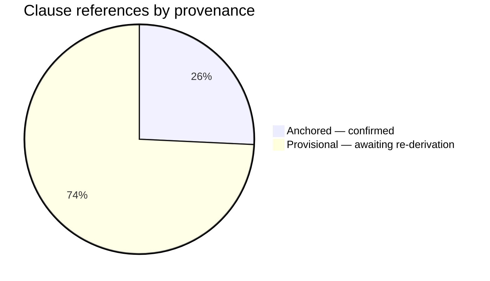
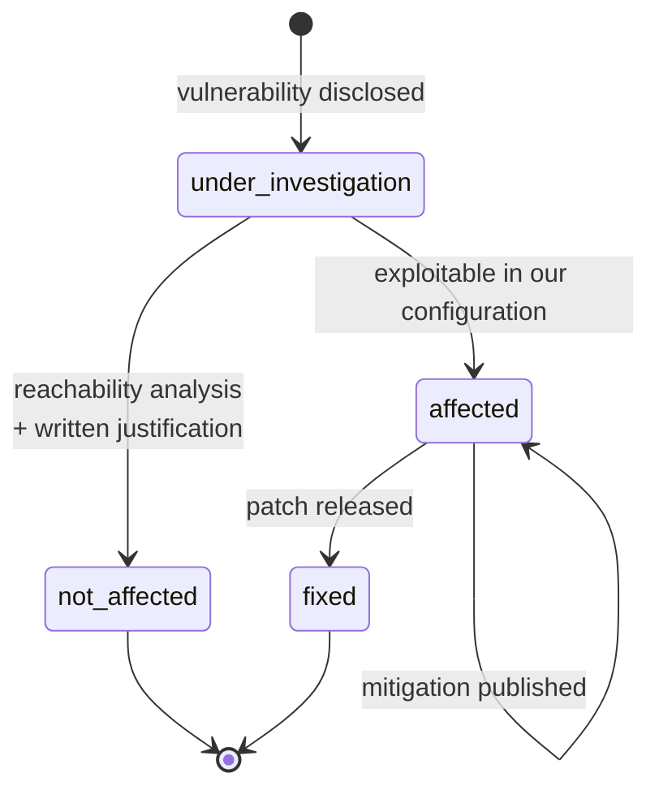
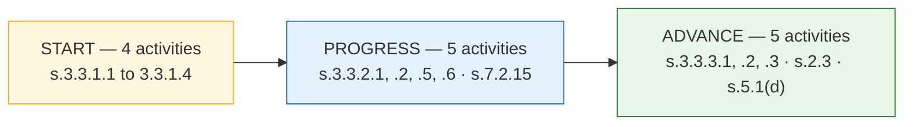

# BOM Automation — CERT-In Compliance Matrix

Every clause of the *CERT-In Technical Guidelines on SBOM, QBOM & CBOM, AIBOM and HBOM*,
**v2.0, 09.07.2025** that this product implements, and exactly where it is implemented.

**Read the provenance column before quoting any clause number.** 26 of 101 clause
references in this product are **anchored** — confirmed against the published guideline.
The remaining 75 are **provisional**: encoded from the tables and not yet re-derived from
the PDF clause by clause. That number is published as it stands, in
`dist/catalogue-audit.md` and regenerated by `make catalogue-audit`, because a provisional
ordinal presented as confirmed is the single defect that would discredit every assessment
this firm issues.



| Source | Confirmed | Total | % |
|---|---:|---:|---:|
| SBOM (s.4.2) | 8 | 21 | 38.1% |
| AIBOM (s.9.3) | 3 | 16 | 18.8% |
| CBOM (s.8.4) | 1 | 20 | 5.0% |
| QBOM (s.8.5) | 1 | 10 | 10.0% |
| HBOM (s.10.2) | 1 | 15 | 6.7% |
| Correlation rules | 5 | 5 | 100.0% |
| SSDLC roadmap (s.3.3) | 7 | 14 | 50.0% |
| **Total** | **26** | **101** | **25.7%** |

Correlation rules are fully anchored because the specification names those section numbers
in prose rather than leaving them to be counted off a table — which is precisely what made
the lane ordinals provisional.

---

## 1. SBOM — s.4.2, twenty-one minimum elements

| Clause | Element | Tier | Determinability | Scope | Provenance |
|---|---|---|---|---|---|
| 4.2(1) | Component Name | critical | auto | entity | provisional |
| 4.2(2) | Version of the Component | critical | auto | entity | provisional |
| 4.2(3) | Component Description | contextual | auto | entity | provisional |
| 4.2(4) | Supplier Name | critical | auto | entity | provisional |
| **4.2(5)** | **Licence** | critical | auto | entity | **anchored** |
| 4.2(6) | Origin / Source Repository | standard | auto | entity | provisional |
| 4.2(7) | Dependencies | critical | auto | entity | provisional |
| **4.2(8)** | **Known Unknowns / Vulnerabilities** | standard | enrich | entity | **anchored** |
| **4.2(9)** | **Patch Status** | standard | enrich | entity | **anchored** |
| **4.2(10)** | **Release Date** | standard | enrich | entity | **anchored** |
| **4.2(11)** | **End-of-Life Date** | standard | enrich | entity | **anchored** |
| **4.2(12)** | **Criticality** | contextual | **human** | entity | **anchored** |
| **4.2(13)** | **Usage Restrictions** | contextual | **human** | entity | **anchored** |
| 4.2(14) | Cryptographic Hash of the Component | standard | auto | entity | provisional |
| 4.2(15) | Executable Property | contextual | auto | entity | provisional |
| 4.2(16) | Archive Property | contextual | auto | entity | provisional |
| 4.2(17) | Structured Property | contextual | auto | entity | provisional |
| 4.2(18) | Unique Identifier of the Component | critical | auto | entity | provisional |
| 4.2(19) | Author / Originator Name | standard | auto | **document** | provisional |
| 4.2(20) | Timestamp | standard | auto | **document** | provisional |
| **4.2(21)** | **CERT-In Unique Identifier** | critical | auto | entity | **anchored** |

Implementation: `backend/app/services/catalogue/sbom.py` ·
lane `backend/app/services/graph/nodes/sbomLane.py`

**4.2(12) and 4.2(13) are consumer determinations.** Criticality is relative to the
*consuming deployment*; Usage Restrictions is a legal determination. A supplier could not
have supplied either. Both are excluded from the supplier score, reported in their own
section, and each carries the consumer action that resolves it.

**4.2(19) and 4.2(20) are document-scoped.** They are properties of the BOM, not of each
component. Probing per component reported them absent across every entity — telling a
supplier they failed a clause they demonstrably met, hidden completely by the weighted
score because 0/855 looks exactly like a genuine gap. Fixing it moved a real
cdxgen-generated document from 28.53% to 38.28% at the time it was measured — the
current figure moves with our dependency set and is regenerated by `make self-boms`.

**4.2(21) is the Table 3 identifier**, formed as
`pkg:supplier/OrganizationName/Component@Version`. It is emitted only when the supplier
organisation resolves from the curated registry or a human-confirmed proposal; otherwise
the field is `not_determinable` with the resolution action, because a plausible-looking
wrong identifier is worse than an admitted absence.

---

## 2. CBOM — s.8.4, four asset types

| Clause | Element | Tier | Asset type |
|---|---|---|---|
| **8.4.1.2** | Cryptographic Asset Name | critical | all |
| 8.4.1.3 | Asset Type (algorithm / key / protocol / certificate) | critical | all |
| 8.4.1.4 | Cryptographic Primitive | critical | algorithm |
| 8.4.1.5 | Mode of Operation | standard | algorithm |
| 8.4.1.6 | Cryptographic Functions | standard | algorithm |
| 8.4.1.7 | Classical Security Level | critical | algorithm |
| 8.4.1.8 | Object Identifier (OID) | standard | algorithm |
| 8.4.1.9 | Key Identifier | critical | key |
| 8.4.1.10 | Key State | standard | key |
| 8.4.1.11 | Key Size | critical | key |
| 8.4.1.12 | Key Creation Date | standard | key |
| 8.4.1.13 | Key Activation Date | contextual | key |
| 8.4.2.1 | Protocol Version | critical | protocol |
| 8.4.2.2 | Cipher Suites | critical | protocol |
| 8.4.3.1 | Certificate Subject | critical | certificate |
| 8.4.3.2 | Certificate Issuer | critical | certificate |
| 8.4.3.3 | Certificate Validity Window | critical | certificate |
| 8.4.3.4 | Certificate Signature Algorithm | standard | certificate |
| 8.4.3.5 | Certificate Format | contextual | certificate |
| 8.4.4.1 | Deployment Context | contextual | **human** |

Implementation: `backend/app/services/catalogue/cbom.py` ·
`backend/app/services/graph/nodes/cbomLane.py`

**Asset-type scope changes the denominator, not the numerator.** A classical security level
is meaningful for an algorithm and meaningless for a certificate. Reporting a certificate as
missing its cipher mode is a category error, not a gap. Out-of-scope assets are excluded
from the denominator — counting them as absent would make the score measure document
composition rather than declaration quality, and counting them as populated would let a
document of ten certificates score 100% on every algorithm field.

### Configuration checks — s.8.4.2 and s.8.4.3

Declaration completeness and configuration acceptability are different measurements. These
read what was declared and judge it:

| Check | Clause | Severity | Detects |
|---|---|---|---|
| `certificateExpired` | s.8.4.3.3 | high | A certificate past its `Not Valid After` date |
| `deprecatedProtocolVersion` | s.8.4.2.1 | high | SSLv3, TLS 1.0, TLS 1.1 |
| `deprecatedCipherSuite` | s.8.4.2.2 | high | RC4, 3DES, NULL, EXPORT, anonymous suites |
| `weakCertificateSignature` | s.8.4.3.4 | high | SHA-1 or MD5 certificate signatures |

### The S20 security review, as tested

| Surface | Proven by |
|---|---|
| XXE in SPDX/CycloneDX XML | A live payload parsed; entity resolves to nothing. Asserted behaviourally — the earlier introspection check read an lxml attribute that does not exist and would have raised on a *safe* parser too |
| Formula injection on XLSX export | `=cmd\|'/c calc'!A1` and every `= + - @ \t \r` lead exported inert, through the real exporter |
| Zip bombs | Refused on the **measured** decompression ratio, not the declared size |
| Nested JSON | Refused beyond 40 levels, checked as it descends rather than by catching `RecursionError` |
| Frontend XSS | Six payloads through the components that render supplier text, asserted inert on the DOM; plus an AST guard over all of `src/` — a grep would match this documentation, which is a mistake the backend suite has made three times |
| Sandbox boundary | A hostile `postinstall` attempting credential harvesting, exfiltration, escape from the tree and outliving the run. A control case proves the payload succeeds *unprotected*, so a containment pass cannot be a broken fixture. Containment tests skip without a container runtime, with a stated reason; the argv guard runs everywhere |

Implementation: `backend/app/services/score/cryptoChecks.py`

**A high-severity configuration finding caps the lane verdict below `pass`.** Coverage
measures whether a supplier *declared* their cryptography; it cannot see that what they
declared is an expired certificate, TLS 1.0 and 3DES. A lane reporting `pass` on that
document would be complete, arithmetically correct, and wrong in the client's favour. The
finding does not zero the score — the assessment reports both measurements — but the
*verdict* may not claim the second when it measured the first.

---

## 3. QBOM — s.8.5

| Clause | Element | Tier |
|---|---|---|
| **8.5.1** | Post-Quantum Migration Strategy | critical |
| 8.5.2 | Quantum System / Model Name | critical |
| 8.5.3 | Vendor | critical |
| 8.5.4 | Country of Origin | standard |
| 8.5.5 | Communication Protocol | standard |
| 8.5.6 | Hardware | standard |
| 8.5.7 | Software Dependencies | standard |
| 8.5.8 | Environmental Impact | contextual |
| 8.5.9 | Attestations and Certifications | standard |
| 8.5.10 | Quantum Exposure of the Consuming Deployment | contextual, **human** |

Implementation: `backend/app/services/catalogue/qbom.py` ·
`backend/app/services/graph/nodes/qbomLane.py`

s.8.5.1 is declared first, matching the guideline's own order. It was previously declared
fourth — a defect the S20 catalogue audit found once the ordering check became
notation-aware, and one that had gone unnoticed because ordering was only ever checked for
the two lanes whose clause notation the old check understood.

**QBOM ships alongside CBOM because Table 8 embeds `Cryptographic Asset` pointing straight
at Table 9.** QBOM adds only what is QBOM-specific on top of the asset model CBOM already
built.

---

## 4. AIBOM — s.9.3

| Clause | Element | Tier | Determinability |
|---|---|---|---|
| **9.3(1)** | Model Name | critical | auto |
| **9.3(2)** | Model Version | critical | auto |
| 9.3(3) | Model Type / Architecture | standard | auto |
| 9.3(4) | Model Developer | critical | auto |
| 9.3(5) | Model Licence | critical | auto |
| **9.3(6)** | Software Dependencies | critical | auto |
| 9.3(7) | Training Data Source | critical | auto |
| 9.3(8) | Data Pre-processing | standard | auto |
| 9.3(9) | Model Inputs | standard | auto |
| 9.3(10) | Model Outputs | standard | auto |
| 9.3(11) | Performance Metrics | standard | auto |
| 9.3(12) | Evaluation Results | standard | auto |
| 9.3(13) | Known Limitations and Biases | standard | auto |
| 9.3(14) | Hardware / Compute Requirements | contextual | auto |
| 9.3(15) | Intended Usage | contextual | **human** |
| 9.3(16) | Out-of-Scope Usage | contextual | **human** |

Implementation: `backend/app/services/catalogue/aibom.py` ·
`backend/app/services/graph/nodes/aibomLane.py`

s.9.3(15) and s.9.3(16) are governance declarations by the consuming organisation, not
supplier facts — the AIBOM counterparts of s.4.2(12)–(13).

---

## 5. HBOM — s.10.2, Table 11

| Clause | Element | Tier | Source |
|---|---|---|---|
| 10.2(1) | Product Name | critical | procurement |
| 10.2(2) | Model Number | critical | procurement |
| 10.2(3) | Serial Number | critical | asset register |
| 10.2(4) | Manufacturer | critical | procurement |
| 10.2(5) | Manufacturing Location | critical | procurement |
| 10.2(6) | Manufacturing Date | standard | procurement |
| 10.2(7) | Supplier Name | critical | purchase record |
| 10.2(8) | Supplier Location | standard | purchase record |
| 10.2(9) | Technology Node | contextual | datasheet |
| 10.2(10) | Warranty / AMC Reference | standard | contract |
| 10.2(11) | Test Results | standard | delivery documentation |
| 10.2(12) | Compliance Declarations | critical | delivery documentation |
| **s.10.2.4** | Firmware Version | critical | artifact or asset register |
| 10.2(13) | Subcomponents | standard | Table 11 recursion |
| 10.2(14) | Deployment Criticality and Siting | contextual | **human** |

Implementation: `backend/app/services/catalogue/hbom.py` ·
`backend/app/services/graph/nodes/hbomLane.py` ·
`backend/app/services/ingest/parsers/assetRegister.py`

**HBOM data is procurement data, not scanner output.** Manufacturer location, manufacturing
date, serial number, technology node, warranty and test results come from asset registers,
purchase records and delivery documentation. The assessment states plainly which claims rest
on a scan and which on a purchase order, because a reader who cannot tell will over-trust
half of them.

**s.10.2(4) and s.10.2.4 are distinct clauses that differ by one character.** `10.2(4)` is
Manufacturer, a row of the Table 11 ordinal list; `s.10.2.4` is the section making the
HBOM-with-SBOM pairing explicit, which `firmware_version` rests on. Both are correct. A
client reading one and checking the other against the PDF concludes the assessment cites the
wrong section, and cannot be talked out of it. The fix is at the point of rendering — section
references carry an `s.` prefix — and the finding is kept visible in
`dist/catalogue-audit.md` so nobody later "corrects" one into the other.

**Ingestion accepts both shapes.** CSV/XLSX asset-register exports *and* CycloneDX, because
CycloneDX 1.6 carries hardware as `type: device`. Routing is by payload shape, not by lane —
routing every HBOM document to the register parser refused a valid CycloneDX HBOM with a
message about our own dispatcher.

---

## 6. Cross-BOM requirements

| Clause | Rule | Severity | Requires | Status |
|---|---|---|---|---|
| **s.8.4.1.2** | `cryptoInSbom` — a cryptographic library in the SBOM with no CBOM declaring assets | high | sbom | live |
| **s.9.3(6)** | `modelDepsInSbom` — AIBOM software dependencies absent from the SBOM | high | aibom + sbom | live |
| **s.8.5.1** | `algorithmQuantumExposure` — RSA, ECC, Diffie-Hellman or DSA with no declared PQC migration path | high | cbom | live |
| **s.10.2.4** | `firmwareInHbom` — declared firmware with no SBOM coverage | medium | hbom + sbom | live |
| **rec. 7.1.6** | `vexCoverage` — vulnerabilities with no VEX statement | critical | sbom | **pending** — reported as pending, never silently missing |

Implementation: `backend/app/services/correlate/rules.py` ·
`backend/app/services/correlate/engine.py`

**A single-lane submission produces zero correlation findings.** A client with only an SBOM
has not failed to declare their cryptography — they were never asked to. A rule whose lanes
are absent is reported as `skipped` with the lane that was missing, because "did not run"
and "found nothing" are different answers.

---

## 7. Vulnerability disclosure — rec. 7.1.6, CSAF 2.0

Four statuses, and there is no fifth:



| Requirement | Implementation |
|---|---|
| Four exhaustive statuses | `services/vex/authoring.py` refuses anything outside them |
| `not_affected` requires justification | Enforced at authoring. An unjustified `not_affected` is an assertion, and the whole point of VEX is that it is not one |
| CSAF 2.0 export | `services/vex/csaf.py`, stored in `csaf_advisories.doc` |
| Applied to ourselves | `SECURITY.md` plus `services/self/vexProcess.py` — a real statement for a real CVE in one of our own dependencies, published in `dist/vex/` in the same format we require of suppliers |

`vex_statements.status` is deliberately a `VARCHAR` rather than a database enum: rec. 7.1.6
could gain a status in a future revision, and a schema migration is a worse place to discover
that than a validator.

---

## 8. SSDLC maturity — s.3.3, fourteen activities



| Phase | Clause | Activity | Observable? |
|---|---|---|---|
| START | s.3.3.1.1 | Generate an SBOM for software you produce | yes — CI artifact |
| START | s.3.3.1.2 | Inventory third-party dependencies | yes — lockfile |
| START | s.3.3.1.3 | Pin dependency versions | yes — lockfile |
| START | s.3.3.1.4 | Require SBOMs from suppliers contractually | **no** — attested |
| PROGRESS | s.3.3.2.1 | Secure installation and operation guidance | yes — document |
| PROGRESS | s.3.3.2.2 | Vulnerability scanning in the pipeline | yes — workflow |
| PROGRESS | s.3.3.2.5 | SBOM integrated into each SSDLC phase | yes — workflow |
| PROGRESS | s.3.3.2.6 | Dependency update process | yes — automation config |
| PROGRESS | s.7.2.15 | Supplier remediation SLAs | **no** — attested |
| ADVANCE | s.3.3.3.1 | VEX statement history | yes — published advisories |
| ADVANCE | s.3.3.3.2 | Incident-response playbook naming VEX | yes — document |
| ADVANCE | s.2.3 | Regeneration on every release, update and patch | yes — release workflow |
| ADVANCE | s.3.3.3.3 | Continuous monitoring of declared components | yes — scheduled job |
| ADVANCE | s.5.1(d) | A named body accountable for supply-chain security | **no** — attested |

Implementation: `backend/app/services/maturity/roadmap.py` ·
`backend/app/services/maturity/evidence.py` ·
`backend/app/services/maturity/scorecard.py`

**Attested is never evidenced**, and the schema refuses to blur them. An evidenced verdict
must name the artifact that proves it; without one it is an assertion, and asserting is what
attestation is for. Three of the fourteen activities are unobservable from any artifact, so
each carries the question that must be asked instead. The console styles an attested verdict
with a dashed border and italics — a scorecard where a client's word and a checked artifact
render identically invites a client to trust the wrong half.

### Our own scorecard, published

`dist/maturity-scorecard.json`, regenerated per release. Position: **below start**. We
publish it as it stands because §11 requires this repository to ship what it asks of
suppliers, and a firm that assessed clients while hiding its own scorecard would deserve the
obvious question.

---

## 9. Other clauses implemented

| Clause | Requirement | Implementation |
|---|---|---|
| s.2.3 | Regeneration on every release, update and patch | `.github/workflows/self-bom.yml` |
| s.3.3.1.4 | SBOM required in procurement | Generated procurement-clause draft, `services/artifacts/pack.py`; adopted in our own `SECURITY.md` |
| s.3.3.2.1 | Secure installation and operation checklist | Generated artifact, `services/artifacts/pack.py` |
| s.3.3.2.5 | SBOM in every SSDLC phase | `services/ci/checkRun.py` + `policy.py`, driven by `.github/workflows/conformance.yml` |
| s.3.3.3.2 | VEX and incident-response playbook | Generated artifact + our own `SECURITY.md` |
| s.5.1 | Roles and responsibilities | Generated RACI draft; s.5.1(d) accountable body is an attested activity |
| s.5.3 | BOM access control and distribution | Generated access rules; enforced by the authorization matrix, repository-layer tenancy, and org-scoped retrieval — the corpus is the one store holding material from every client at once |
| s.6(d) | Shift-left scanning | The CI conformance gate, `services/ci/policy.py` |
| rec. 7.1.2 | Sector sensitivity | `clients.sector` — govt, PSU, essential, private |
| rec. 7.1.5 | An unreadable document is not a clean one | `DocumentStatus.UNREADABLE`; never an empty component list |
| rec. 7.1.6 | Four VEX statuses | `services/vex/authoring.py` |
| rec. 7.2.2 | SBOM in CI/CD | `services/ci/checkRun.py` builds the pull-request conformance check; `services/webhookService.py` signs outbound deliveries |
| Table 3 | CERT-In unique identifier | `services/identifiers/` — `pkg:supplier/OrganizationName/Component@Version` |
| Table 8 / Table 9 | Cryptographic asset model | `services/catalogue/cbom.py` + `qbom.py` |
| Table 11 | Hardware elements with subcomponent recursion | `services/catalogue/hbom.py` |

---

## 10. What this product deliberately does not do

Stated plainly, because a conformance tool that overstates its own scope is the first thing
a real auditor tests.

| Not done | Why |
|---|---|
| **Issue legal or regulatory opinions** | Generated procurement clauses and RACI matrices are drafts for counsel. Every one carries a review notice. A generated clause that reads as counsel's work product is the one output here that could cause real harm taken at face value. |
| **Let a language model produce a verdict, a figure or a clause reference** | Those come from `services/score/` and `services/catalogue/`. Enforced in code — a citation that does not resolve to the pinned guideline version stops the render, and there is no bypass flag. A flag would eventually be used by someone under deadline. |
| **Certify compliance** | This product measures conformance of a *declaration* against the guideline's minimum elements. Certification is a regulatory act. |
| **Claim the catalogue is verified** | 25.7% of clause references are confirmed. The rest are provisional and labelled so. `services/catalogue/audit.py` produces the worksheet an assessor works through and states that it cannot perform the audit itself — re-deriving a clause from a PDF is a person reading a PDF, and code claiming otherwise would manufacture the assurance it exists to measure. |
| **Decide anything agentically** | Every agentic output is a proposal carrying evidence, confidence and hop count, queued for human confirmation. |
| **Assess an unreadable document as clean** | It is `unreadable` with a reason, never an empty component list. |
| **Run untrusted build scripts unprotected** | Generation refuses when no container runtime can provide network isolation. |

---

## 11. Verifying these claims

```bash
make catalogue-audit   # every clause reference with its provenance
make scale             # the 50,000-component budget and per-lane p95
make self-bom          # this repository's own SBOM
make test              # 806 backend cases, 36 frontend
```

Published artifacts in `dist/`:

| File | Contents |
|---|---|
| `catalogue-audit.md` | All 101 clause references, anchored vs provisional, plus instrument findings |
| `maturity-scorecard.json` | Our own s.3.3 position, evidenced vs attested per activity |
| `scale-report.md` | Measured 50,000-component figures and per-lane p95 |
| `bom-automation.cdx.json` | Our own SBOM |
| `bom-automation.aibom.cdx.json`, `bom-automation.cbom.cdx.json` | Our own AIBOM and CBOM |
| `vex/` | Published CSAF advisories for vulnerabilities in our own dependencies |

---

*Guideline basis: CERT-In v2.0, 09.07.2025. See
[PRODUCT_SPECIFICATION.md](PRODUCT_SPECIFICATION.md),
[ARCHITECTURE.md](ARCHITECTURE.md), [DATA_MODEL.md](DATA_MODEL.md).*
