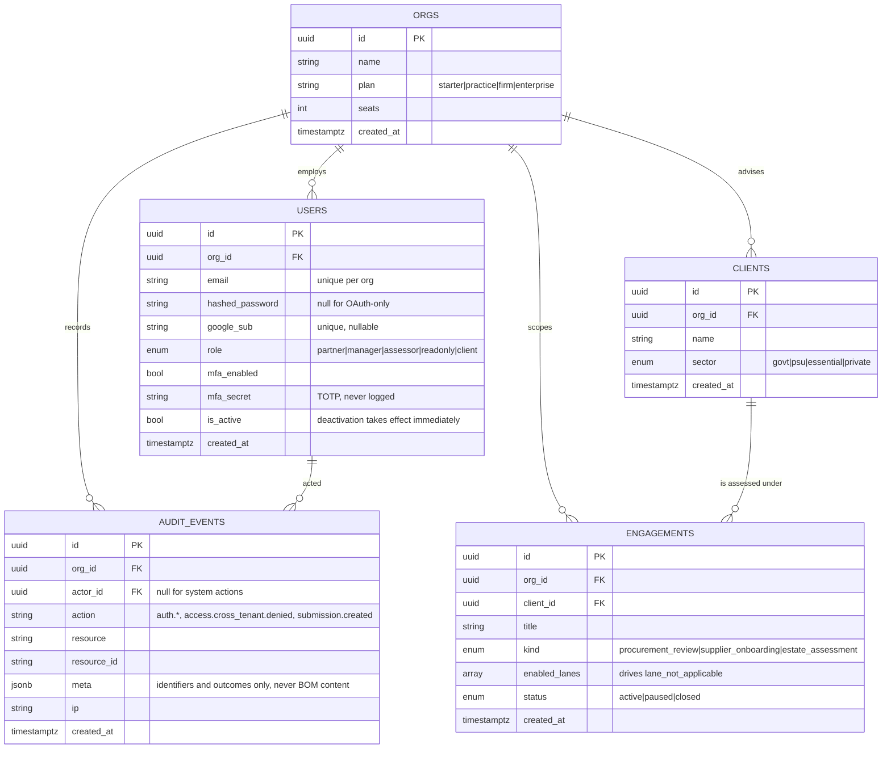
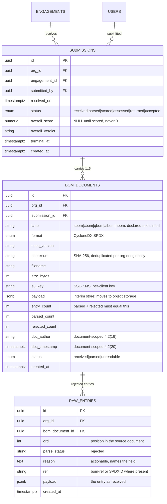
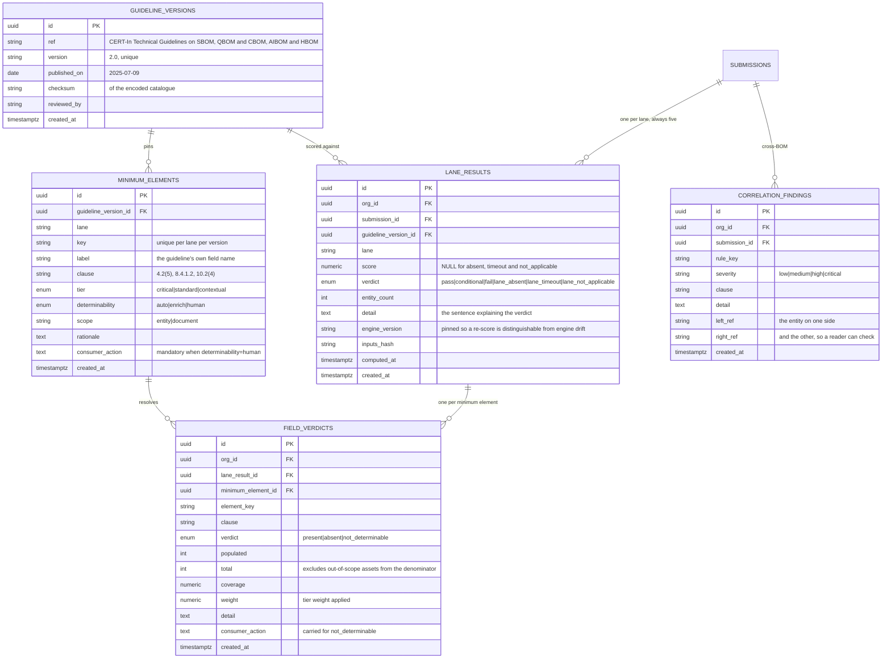
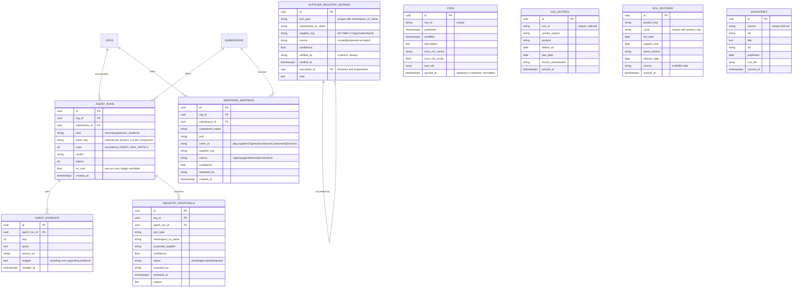
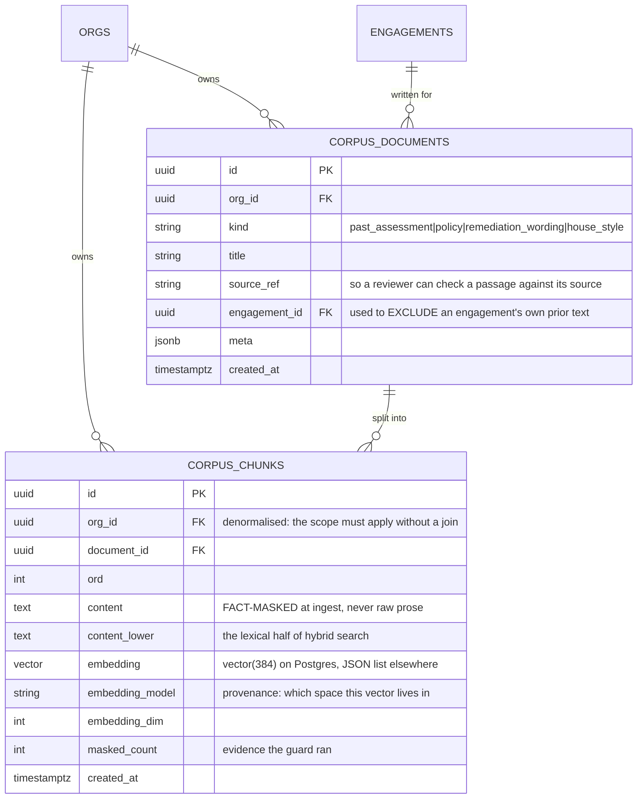
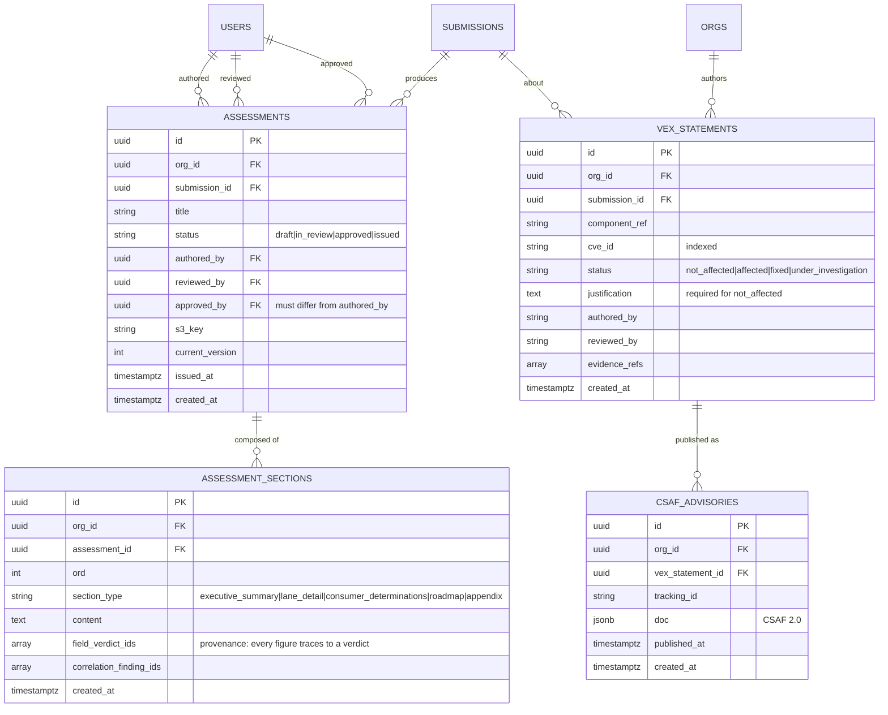
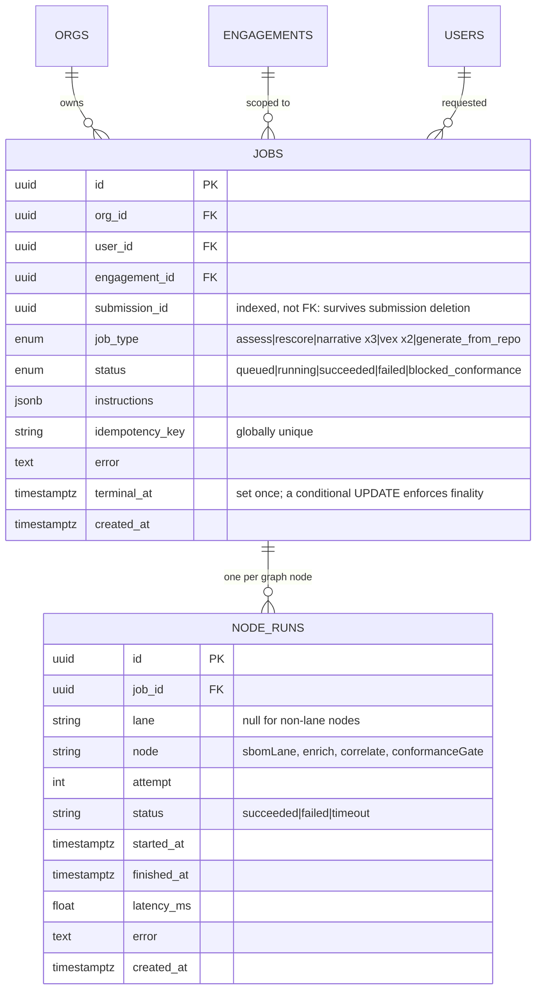
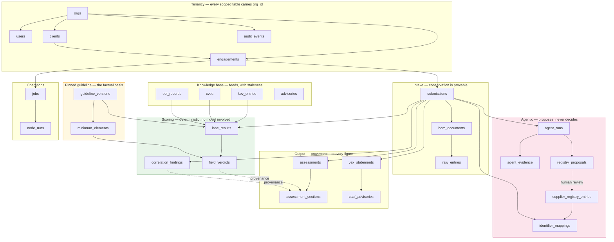

# BOM Automation — Data Model

**30 tables, 9 migrations, one tenant boundary.** Every diagram here is generated from
the SQLAlchemy models in `backend/app/models/` and matches `alembic/versions/`.

Conformance basis: *CERT-In Technical Guidelines on SBOM, QBOM & CBOM, AIBOM and HBOM*,
**v2.0, 09.07.2025**. Every clause reference stored in this schema resolves to a row in
`minimum_elements` for the pinned `guideline_versions.version`, or the assessment refuses
to render.

---

## 1. Design rules the schema enforces

| Rule | How the schema carries it |
|---|---|
| **Tenancy is enforced at the repository layer, never the router** | Every tenant-scoped table carries `org_id` with an FK to `orgs`. No repository method accepts an id alone; `TenantScopedRepository.scoped()` is the only query entry point. |
| **A score is never defaulted to zero** | `submissions.overall_score` and `lane_results.score` are `NUMERIC(5,2) NULL`. Null means *not scored*; zero is a real and much worse verdict. |
| **`not_determinable` is never `compliant`** | `field_verdicts.verdict` is a three-state enum. `not_determinable` rows carry a mandatory `consumer_action` and are excluded from the weighted score. |
| **`lane_not_applicable` ≠ `lane_absent`** | Distinct values of the `lane_verdict` enum. The first is excluded from the overall score; the second is a reported finding. |
| **Nothing is dropped silently** | `bom_documents.entry_count = parsed_count + rejected_count`, and every rejection is a `raw_entries` row with a reason. |
| **A clause reference must resolve** | `field_verdicts.clause` is checked against `minimum_elements` for the pinned guideline version before any export renders. |
| **Agents research; they never decide** | `registry_proposals` is a separate table from `supplier_registry_entries`. A proposal reaches the registry only through a human review that writes `verified_by`. |
| **Attested is never evidenced** | Maturity verdicts carry a `basis`; an evidenced verdict without an artifact reference cannot be constructed. |
| **A terminal job stays terminal** | `jobs.terminal_at` plus a conditional `UPDATE ... WHERE terminal_at IS NULL`, so a late worker cannot resurrect a finished job. |

---

## 2. Tenancy and identity

**`enabled_lanes` is the applicability switch.** A client with no quantum hardware has
nothing to declare, so QBOM reports `lane_not_applicable` and leaves the overall score
alone. A client running cryptography with no CBOM has *failed to declare it*, and that is
`lane_absent` — a finding. Conflating the two produces either a false accusation or a
false pass, which is why it is data rather than an inference.

**`audit_events` is the only record of a refused cross-tenant read.** The caller receives
a 404 indistinguishable from a genuine miss, so nothing else records that the attempt
happened. The row deliberately does **not** name the owning org: knowing the resource
belonged to *someone else* is what a reviewer needs, and naming the victim would place
one tenant's identity inside another tenant's audit trail.

---

## 3. Submission and ingestion

**The conservation invariant.** `entry_count = parsed_count + rejected_count` for every
document, and each rejection is a durable row. This answers the question that decides
whether a client trusts the report: *"why does your assessment say 380 components when I
sent 400?"* An engine that silently drops twenty entries produces a cleaner-looking
score and an indefensible one.

**Checksums deduplicate within a tenant only.** The same public SBOM produces the same
checksum for every client who submits it, so a global unique constraint would leak the
fact that another tenant holds that document. `find_by_checksum` is org-scoped.

**Document scope is a first-class distinction.** `doc_author` and `doc_timestamp` are
properties of the document, not of each component. Probing for them per component would
report them absent across every entity and tell a supplier they failed a clause they
demonstrably met — a false negative the weighted score hides completely, because 0/855
looks exactly like a genuine gap.

---

## 4. Scoring output

### Element inventory, as encoded

| Lane | Clause root | Elements | critical / standard / contextual | auto / enrich / human |
|---|---|---:|---|---|
| SBOM | s.4.2 | 21 | 7 / 8 / 6 | 15 / 4 / 2 |
| CBOM | s.8.4 | 20 | 11 / 6 / 3 | 19 / 0 / 1 |
| QBOM | s.8.5 | 10 | 3 / 5 / 2 | 9 / 0 / 1 |
| AIBOM | s.9.3 | 16 | 6 / 7 / 3 | 14 / 0 / 2 |
| HBOM | s.10.2 | 15 | 8 / 5 / 2 | 14 / 0 / 1 |
| **Total** | | **82** | **35 / 31 / 16** | **71 / 4 / 7** |

**`determinability` decides who is accountable for an absence.**

- `auto` — readable from the artifact. Absent means the supplier did not declare it.
- `enrich` — resolvable from an external feed (NVD, KEV, endoflife.date). Absent after
  enrichment is still a supplier gap, but the feed outage is reported distinctly.
- `human` — **the supplier could not have supplied it.** Criticality, s.4.2(12), is
  relative to the consuming deployment. Usage Restrictions, s.4.2(13), is a legal
  determination. Intended and Out-of-Scope Usage, s.9.3(15)–(16), are governance
  declarations. Scoring these as defects produces a report that is wrong in the client's
  favour; scoring them as compliant puts a green tick on a field nobody checked. Both end
  with a client failing a real audit while holding our assessment. So they leave the
  supplier score entirely, are reported in their own section, and each carries the
  `consumer_action` that resolves it.

Seven elements are `human` across the five lanes. The schema refuses to construct one
without a `consumer_action`, because a `not_determinable` verdict with no action reads as
a shrug.

---

## 5. Enrichment, identifiers and the agentic loop

**Two tables for one fact, deliberately.** `registry_proposals` and
`supplier_registry_entries` hold the same shape of information and are separated by a
human. An agent researches a component's supplier, records what it read, how confident it
is and how many hops it took, and files a *proposal*. Nothing reaches the curated registry
without a review that writes `verified_by`. Merging them would make an agent's guess
indistinguishable from a verified fact the next time anyone read the table — and the Table
3 CERT-In identifier is built from `supplier_org`, so a wrong guess propagates into every
identifier the firm issues for that component.

**`agent_evidence` retains non-supporting snippets.** A reviewer confirming a proposal
needs to see what the agent read and rejected, not only what it kept. Evidence that only
ever agrees with the conclusion is not evidence.

**`synced_at` on every feed table.** An enrichment result derived from a four-week-old KEV
snapshot is reported as such. Feed staleness that is invisible becomes a client asking why
a KEV-listed CVE was not flagged.

---

## 5a. The corpus — retrieval, and the tenant boundary it depends on

**`org_id` is denormalised onto the chunk deliberately.** The scope predicate has
to be applicable to the chunk query itself — requiring a join to know which tenant
a chunk belongs to is exactly how a scope gets forgotten. Both tables are
constrained anyway, so a join that is ever loosened still cannot cross the
boundary.

**`content` is fact-masked before the row is written.** The corpus holds the firm's
prose across every client it has ever assessed, and its purpose is to surface
passages from one engagement while drafting another. Percentages, clause
references, CVE identifiers and dates are replaced with typed placeholders at
ingest, so a figure belonging to one client cannot be retrieved into another's
report. `masked_count` records how many were removed — non-zero is healthy, and
zero across a whole corpus of past assessments would mean the masker silently
stopped matching.

**`embedding_model` and `embedding_dim` are recorded per chunk, not assumed
globally.** Change the embedder, leave the old vectors in place, and cosine
similarity still returns a perfectly plausible number computed over two unrelated
coordinate systems. The ranking looks fine and is noise. `assert_comparable`
refuses rather than letting that happen silently.

---

## 6. Assessment, review gate and VEX

**`vex_statements.status` is a plain `VARCHAR`, not a database enum**, and that is a
deliberate departure from every other status column here. Recommendation 7.1.6 names four
statuses and could gain a fifth in a future revision of the guideline; a schema migration
is a worse place to discover that than a validator. `services/vex/authoring.py` is the
authority and refuses anything outside the four.

**`assessment_sections.field_verdict_ids` is an array rather than a join table.** The ids
are read whole, always together with the section, and never queried in the reverse
direction. A join table would add a second read to every provenance lookup to answer a
question nobody asks.

**The review gate is three distinct columns.** An assessment cannot reach `issued` without
`approved_by` set, and `approved_by` may not equal `authored_by` — the assessor who ran
the assessment is the same pair of eyes however senior they are. Rank alone cannot express
that, so it is a constraint in the workflow service and a permission in the matrix.

---

## 7. Jobs and per-lane telemetry

**`node_runs` is what makes the fan-out auditable.** Two lane rows whose
`[started_at, finished_at]` intervals overlap prove the lanes ran concurrently; disjoint
intervals would mean a graph that only reads as parallel. `latency_ms` per lane is also the
source of the p95 figures in `dist/scale-report.md`.

**`blocked_conformance` is a job status, not an error.** A citation that does not resolve
to the pinned guideline version stops the render deliberately. It is a refusal, and
recording it as a failure would make a working safety mechanism look like a bug.

---

## 8. Whole-schema overview

---

## 9. Indexes and constraints that carry a rule

| Object | Table | Why it exists |
|---|---|---|
| `uq_users_org_id_email` | `users` | The same person may hold accounts at two advisory firms. Email is unique *per org*, not globally. |
| `uq_users_google_sub` | `users` | One Google identity maps to one account, globally — otherwise OAuth sign-in is ambiguous. |
| `uq_bom_documents_org_id_checksum` | `bom_documents` | Deduplicates a resubmitted document *within* a tenant. Global uniqueness would leak that another tenant holds the same public SBOM. |
| `uq_jobs_idempotency_key` | `jobs` | A retried commit must not enqueue a second assessment. |
| `ix_jobs_live` — partial, `WHERE terminal_at IS NULL` | `jobs` | The worker's hot query is "what is still running in this tenant"; a full index would be mostly dead rows. |
| `ix_lane_results_submission_id_lane` | `lane_results` | Every read is "the five lanes of this submission". |
| `ix_field_verdicts_lane_result_id_verdict` | `field_verdicts` | The gap register reads one lane's *unmet* elements; filtering by verdict is the query, and clause ordering is applied after. |
| `uq_minimum_elements_version_lane_key` | `minimum_elements` | Two elements claiming one key in a lane means one of them is wrong. |
| `uq_guideline_versions_version` | `guideline_versions` | One row per published guideline version, ever. |
| `uq_supplier_registry_type_namespace` | `supplier_registry_entries` | A component resolves to exactly one supplier organisation. |
| `ix_audit_events_org_id_created_at` | `audit_events` | Audit review is always "this tenant, this window". |

---

## 10. Migrations

| Revision | Adds |
|---|---|
| `0001_foundation` | `orgs`, `users`, `jobs`, `node_runs`, `guideline_versions`, and every native enum type |
| `0002_submissions` | `clients`, `engagements`, `submissions`, `bom_documents`, `lane_results`, `field_verdicts` |
| `0003_auth` | MFA columns, Google identity, the partial index on live jobs |
| `0004_ingestion_catalogue` | `raw_entries`, `minimum_elements`, element scope |
| `0005_correlation` | `correlation_findings` |
| `0006_enrichment_identifiers` | `cves`, `kev_entries`, `eol_records`, `advisories`, `agent_runs`, `agent_evidence`, `supplier_registry_entries`, `registry_proposals`, `identifier_mappings` |
| `0007_vex_assessments` | `vex_statements`, `csaf_advisories`, `assessments`, `assessment_sections` |
| `0008_generation_job_type` | `generate_from_repo` on the `job_type` enum |
| `0009_corpus_retrieval` | `corpus_documents`, `corpus_chunks`, the `vector` extension and the full-text index |

Every migration is hand-reviewed. `tests/test_migrations.py` asserts that
`upgrade head → downgrade base → upgrade head` round-trips, that every native enum type
created on the way up is dropped on the way down, and that tables drop in reverse
dependency order.

**Migration 0008 is the awkward one and documents why.** PostgreSQL has no `DROP VALUE`,
so removing an enum value means rebuilding the type. The downgrade renames the old type
aside, recreates it without the new value, and casts the column across — which *fails
loudly* if any row still carries the removed value. That is the correct outcome: silently
dropping those rows' type would corrupt the job log.

---

## 11. Retention and data protection

| Concern | Treatment |
|---|---|
| BOM payloads | Object storage, `ap-south-1`, presigned access only, SSE-KMS with a per-client key. A BOM is an architecture disclosure and this system holds many suppliers' at once. |
| Retention | `SUBMISSION_RETENTION_DAYS`, default 1095 (three years) — the assessment must outlive the audit that relies on it. |
| Logs | `utils/redaction.py` runs as the **last** structlog processor before rendering, so nothing a later processor adds escapes it. No internal hostname, filesystem path, email or secret from a BOM reaches log storage. Logs outlive engagements. |
| MFA secrets | `users.mfa_secret` is never logged and never returned by any endpoint. |
| Audit metadata | `audit_events.meta` carries identifiers and outcomes only. Component names are supplier-controlled text and a component list is an architecture disclosure. |

---

*Generated from `backend/app/models/` at 30 tables. Guideline basis: CERT-In v2.0,
09.07.2025. See [PRODUCT_SPECIFICATION.md](PRODUCT_SPECIFICATION.md) and
[ARCHITECTURE.md](ARCHITECTURE.md).*
