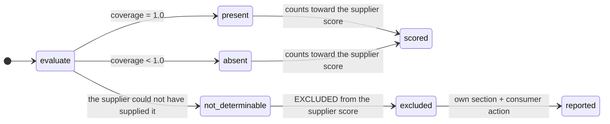
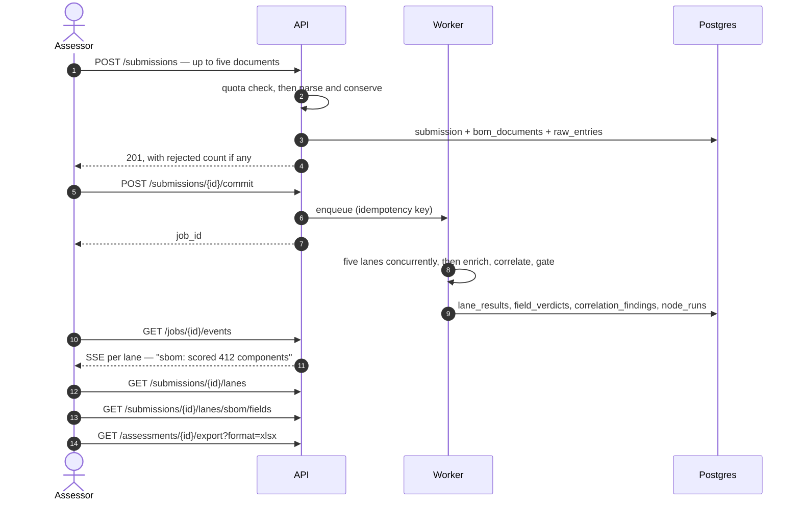
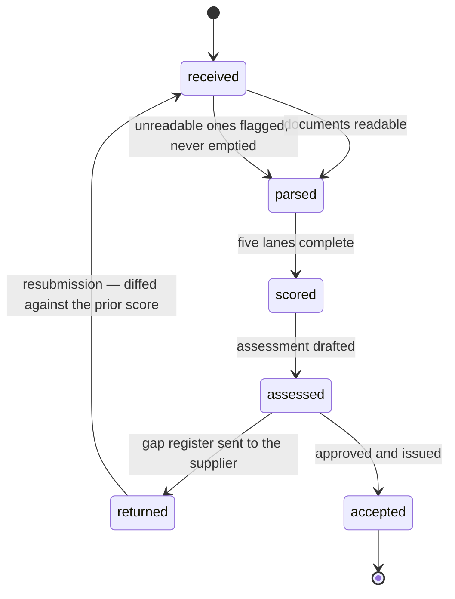
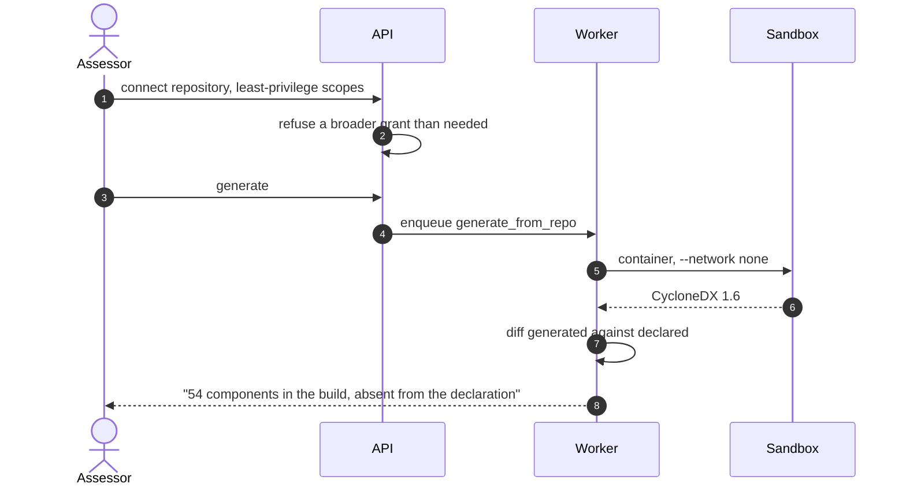
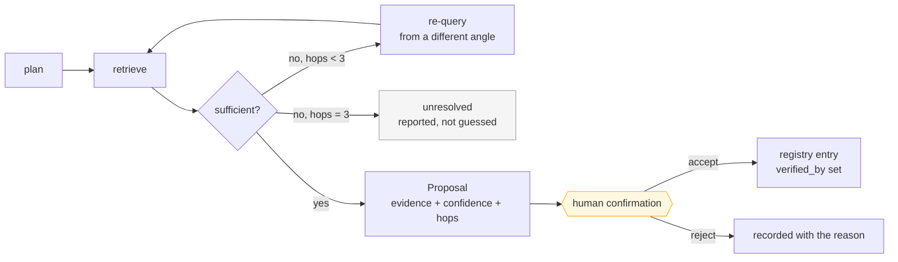

# BOM Automation — Product Specification

**Version 1.0 · 2026-08-05**

A CERT-In conformance and attestation platform. It receives Bills of Materials from
suppliers, scores them against the encoded minimum elements of the *CERT-In Technical
Guidelines on SBOM, QBOM & CBOM, AIBOM and HBOM* **v2.0, 09.07.2025**, produces defensible
assessments with a clause reference behind every figure, and tracks a client's own SSDLC
maturity against s.3.3.

Companion documents: [ARCHITECTURE.md](ARCHITECTURE.md) · [DATA_MODEL.md](DATA_MODEL.md) ·
[COMPLIANCE_MATRIX.md](COMPLIANCE_MATRIX.md)

---

## 1. What this is for

India's procurement mandate creates a specific, unpleasant situation for a consuming
organisation. A supplier sends a CycloneDX file. Somebody has to decide whether it meets
the guideline. Doing that by hand across four hundred components and twenty-one minimum
elements takes days, produces inconsistent answers between reviewers, and cannot be
defended in an audit six months later when nobody remembers why a particular field was
accepted.

This product does that assessment deterministically and shows its work. Every figure it
prints traces to a field verdict; every field verdict traces to a clause; every clause
resolves to a row in the pinned guideline version or the report refuses to render.

### The failure this design is organised around

An assessment that is **wrong in the client's favour**. A green tick on a field nobody
checked. A score of 92% over the eleven components whose licences happened to be readable.
A `not_determinable` field counted as compliant because it was easier. Each of those
produces a client who fails a real audit while holding our assessment, and that ends the
product — not the engineering, the business.

Almost every rule below is a consequence of refusing that failure.

### Scope

**Consumer-side.** A client *receiving* BOMs wants conformance scoring, supplier chasing
and gap reports. A vendor *shipping* to government wants generation, identifier mapping and
VEX maintenance. Same guideline, opposite products. This one assesses.

Generation exists, but only because assessing a supplier's declared SBOM against one
generated from their own repository produces the strongest finding the tool can make: *"54
components are present in your build and absent from your declaration."*

---

## 2. Non-negotiable rules

These are the product. They are enforced in code and asserted by tests, not stated as
guidance.

| # | Rule | Enforced by |
|---|---|---|
| 1 | **The LLM never produces a verdict, a figure or a clause reference.** | `validators/conformanceValidator.py` — a citation that does not resolve to the pinned guideline version stops the render. There is no bypass flag; a flag would eventually be used by someone under deadline. |
| 2 | **`not_determinable` is never `compliant`.** | Excluded from the supplier score, reported in its own section, paired with the consumer action required. `MinimumElement` refuses construction of a `human` element without a `consumer_action`. |
| 3 | **Nothing is dropped silently.** | `entry_count = parsed_count + rejected_count` per document, with every rejection a durable `raw_entries` row carrying an actionable reason. |
| 4 | **Partial coverage is not a pass.** | Licences on 12 of 400 components has not met s.4.2(5). Coverage below 1.0 is `absent`, with the ratio reported beside it. |
| 5 | **Lanes fail independently.** | An absent or timed-out lane is a reported finding, never a crashed assessment. |
| 6 | **`lane_not_applicable` ≠ `lane_absent`.** | Distinct enum values. The first is excluded from the overall score; the second is a finding. |
| 7 | **Agents research; they never decide.** | Every agentic output is a proposal carrying evidence, confidence and hop count, in a separate table, queued for human confirmation. |
| 8 | **Tenancy is enforced at the repository layer, never the router.** | `TenantScopedRepository.scoped()` is the only query entry point; an AST test fails the build on a bare `select(self.model)`. |
| 9 | **Attested is never evidenced.** | An evidenced maturity verdict without an artifact reference cannot be constructed. |
| 10 | **We ship what we ask for.** | This repository publishes its own SBOM, AIBOM, CBOM, VEX advisories and maturity scorecard per release, scored by its own engine, whatever the numbers say. |

---

## 3. The three-state verdict model

Most conformance tools have two states. That is the root of the wrong-in-the-client's-favour
failure, and this one has three.



| Verdict | Meaning | Effect on the score |
|---|---|---|
| `present` | Every applicable entity populates the field | Counts, at full weight |
| `absent` | Some or no applicable entity populates it | Counts, with the coverage ratio reported |
| `not_determinable` | **No supplier could have supplied this** | **Excluded**, reported separately with the consumer action |

Seven of the eighty-two encoded elements are `not_determinable` by construction:
s.4.2(12) Criticality, s.4.2(13) Usage Restrictions, s.8.4.4.1 Deployment Context,
s.8.5.10 Quantum Exposure, s.9.3(15) Intended Usage, s.9.3(16) Out-of-Scope Usage, and
s.10.2(14) Deployment Criticality and Siting.

Scoring these as defects produces a report that is wrong in the *supplier's* disfavour, and
a supplier who can show a field was never theirs to provide discredits the whole
assessment. Scoring them as compliant is the other failure. Both are avoided by refusing to
score them at all — and by naming, for each one, the action the consuming organisation must
take.

### Lane verdicts

| Verdict | When | Counts toward the overall score? |
|---|---|---|
| `pass` | ≥ 85% with no critical gap and no severe configuration finding | yes |
| `conditional` | 60–85%, or ≥ 85% capped by a configuration finding | yes |
| `fail` | < 60%, or any critical element at zero coverage | yes |
| `lane_absent` | Lane implemented and enabled, no document submitted | **yes — it is a finding** |
| `lane_timeout` | Exceeded `LANE_TIMEOUT_SECONDS` | yes — reported as infrastructure |
| `lane_not_applicable` | Not in the engagement's `enabled_lanes` | **no — excluded** |

---

## 4. Scoring

### Weighting

```
lane score = Σ(coverage × tier weight) / Σ(tier weight)
             over elements where scores_against_supplier is true
```

| Tier | Weight | Meaning |
|---|---:|---|
| critical | 3.0 | The BOM is unusable without it |
| standard | 2.0 | Required by the guideline, degrades usefulness |
| contextual | 1.0 | Improves the declaration |

Thresholds: `PASS_THRESHOLD = 85.0`, `CONDITIONAL_FLOOR = 60.0`,
`ENGINE_VERSION = 0.1.0` written onto every lane result so a re-score is distinguishable
from a drift in the engine.

### Three overrides that are not arithmetic

**A critical element at zero coverage fails the lane at any score.** A BOM with no versions
can score respectably on descriptive fields while being useless for every purpose the
guideline exists to serve.

**Out-of-scope assets leave the denominator.** A classical security level is meaningful for
an algorithm and meaningless for a certificate. Excluding them keeps the score measuring
declaration quality rather than document composition.

**A high-severity configuration finding caps the verdict below `pass`.** Declaration
completeness and configuration acceptability are different measurements; the verdict may not
claim the second when it measured the first.

---

## 5. The five lanes

| Lane | Clause root | Elements | Input formats |
|---|---|---:|---|
| SBOM | s.4.2 | 21 | CycloneDX JSON/XML, SPDX JSON, SPDX tag-value |
| CBOM | s.8.4 | 20 | CycloneDX 1.6 cryptographic assets |
| QBOM | s.8.5 | 10 | CycloneDX 1.6 |
| AIBOM | s.9.3 | 16 | CycloneDX 1.6 model cards |
| HBOM | s.10.2 | 15 | CSV / XLSX asset register, **or** CycloneDX `type: device` |

Full element inventory: [COMPLIANCE_MATRIX.md](COMPLIANCE_MATRIX.md).

**Lane enablement is configuration, not code.** All five are implemented; an engagement
enables only the lanes its client actually has. A disabled lane reports
`lane_not_applicable` and is excluded from the overall score.

**Lane is declared by the caller, never sniffed from the payload.** A mis-detected facet
scores against the wrong catalogue, which is worse than a rejection because it produces a
confident wrong answer.

---

## 6. Cross-BOM correlation

The class of finding no single-lane tool can produce, and the clearest justification for
running five lanes over one submission rather than five separate tools.

| Rule | Clause | Severity | Finding |
|---|---|---|---|
| `cryptoInSbom` | s.8.4.1.2 | high | OpenSSL, libsodium, wolfSSL or Bouncy Castle in the SBOM with no CBOM declaring assets |
| `modelDepsInSbom` | s.9.3(6) | high | The AIBOM names `torch`; the SBOM does not — the SBOM is incomplete |
| `algorithmQuantumExposure` | s.8.5.1 | high | RSA, ECC, Diffie-Hellman or DSA declared with no PQC migration path |
| `firmwareInHbom` | s.10.2.4 | medium | Declared firmware with no SBOM coverage |
| `vexCoverage` | rec. 7.1.6 | critical | *Pending* — reported as pending, never silently missing |

**A single-lane submission produces zero correlation findings.** Correlating against nothing
is invention. A rule whose lanes are absent is reported as `skipped` **with the lane that was
missing**, because "did not run" and "found nothing" are different answers and a client
deserves to know which one they got.

---

## 7. Roles and permissions

Five roles × eleven resources × seven actions, as an exhaustive matrix rather than spot
checks — so adding a resource forces a decision about who may reach it.

| Role | Reach |
|---|---|
| `partner` | Everything in the tenant, including deletion and user management |
| `manager` | Everything except deletion and user management; **may approve** |
| `assessor` | Runs assessments; **may never approve one**; cannot write the supplier registry |
| `readonly` | Reads and exports; creates nothing |
| `client` | **Read-only, one engagement**; cannot see the firm's curated registry or identifier mappings |

Four invariants asserted over the whole table:

- Only `partner` may delete. Deletion is the one action with no undo.
- No role may write the audit trail. An audit trail the application can edit is not one.
- **read implies list** — denied listing plus permitted reads is an enumeration oracle.
- No role may update what it cannot read.

**The review gate.** An assessment cannot reach `issued` without approval from a `manager`
or above, **and the assessor who ran it may never approve it**, however senior they are.
Rank cannot express that, so it is a separate check. Unapproved exports carry an
`AI-ASSISTED DRAFT — NOT REVIEWED` watermark.

**Tenancy sits underneath all of this and no role grants it.** A partner at firm A has no
more reach into firm B than an anonymous request does.

---

## 8. Workflows

### Assess a supplier submission



### Return to supplier and re-assess



`returned` is a first-class state, not an error. Returning a submission with its gap register
attached is the workflow this product exists to support, and a resubmission is diffed against
the prior score so improvement is visible rather than asserted.

### Repository generation and the declaration diff



If no container runtime can provide network isolation, generation **refuses**. Dependency
resolution executes the repository's own build scripts; a fallback that runs them
unprotected is how that becomes a breach.

---

## 9. Enrichment and the agentic loop

Four elements are `enrich` rather than `auto`: s.4.2(8) Vulnerabilities, s.4.2(9) Patch
Status, s.4.2(10) Release Date, s.4.2(11) End-of-Life Date. They are resolvable from external
feeds.

| Feed | Provides | Freshness |
|---|---|---|
| NVD | CVE records, CVSS v3.1 | `synced_at` per record |
| CISA KEV | Known-exploited catalogue (~1,660 entries) | TTL-cached, synced by a scheduled job |
| endoflife.date | EOL and support-end dates per release cycle | `synced_at` |
| OSV / GHSA | Advisories | `synced_at` |

**A feed outage is a reported finding, not a silent zero.** `feeds_unavailable` names each
feed and why, and enrichment never re-scores a lane that carried no entities — turning an
infrastructure failure into a supplier verdict is the same class of error as scoring
`not_determinable` as compliant.

**The KEV catalogue is synced on a schedule, not per assessment.** Twenty concurrent
assessments downloading 1,660 entries each is a self-inflicted outage.

### The bounded loop



Bounded by `AGENT_MAX_HOPS = 3`, batched at `AGENT_BATCH_SIZE = 50` **per product rather
than per component** — four hundred components of the same library is one research question,
not four hundred — and filtered at `AGENT_MIN_CONFIDENCE = 0.6`.

**A proposal with no supporting evidence cannot be constructed.** Non-supporting evidence is
retained deliberately: a reviewer needs to see what the agent read and rejected, not only
what it kept.

**A model is wired in for narrative wording only**, behind `NARRATIVE_ENABLED` and off by
default. It never touches a verdict, a figure or a clause reference: it receives the facts as
inputs and may only restate them, and `narrative/drafter.verify` refuses a draft asserting
anything else. The agentic enrichment loop still retrieves from deterministic feeds.

---

## 10. Outputs

| Format | Contents | Notes |
|---|---|---|
| PDF | Full assessment | 501 rather than 500 if the renderer is unavailable, naming the formats that do work |
| DOCX | Full assessment | Editable for firm letterhead |
| XLSX | Gap register, one tab per lane | Clause column intact; supplier-controlled names rendered inert against formula injection |
| JSON | Machine-readable verdicts | Every figure with its provenance ids |
| CSAF 2.0 | VEX advisories | rec. 7.1.6 |

Section structure: executive summary → per-lane detail → **consumer determinations in their
own section** → prioritised remediation roadmap → appendix of every field verdict.

**Ordered by tier, not by clause number.** A reader asking "what do I fix first" is not
served by a list that starts at 4.2(1).

**Every figure carries provenance.** `assessment_sections.field_verdict_ids` records exactly
which verdicts produced each number, and `figureProvenanceValidator` refuses to render a
figure that has none.

**The gap register is usable without editing.** A spreadsheet a client must reformat before
they can assign work is a register they will reformat wrongly, and the clause column is the
first thing lost.

---

## 11. Quotas and plans

| Quota | starter | practice | firm | enterprise |
|---|---:|---:|---:|---:|
| Submissions / month | 25 | 250 | 2,000 | unlimited |
| Components / submission | 5,000 | 50,000 | 50,000 | unlimited |
| Repository generations / month | 5 | 50 | 400 | unlimited |
| API requests / minute | 120 | 600 | 1,200 | unlimited |

**Unlimited is `None`, not a large number.** A sentinel like 999,999 eventually gets
compared, logged and displayed, and then somebody has to explain a limit that does not exist.

**An unrecognised plan gets the most restrictive limits.** A typo in a plan column must not
silently grant unlimited service; the failure should be a 429 the client can query, not a
bill we discover later.

**Generation is metered far more tightly than submission.** It resolves dependencies in a
sandbox and takes minutes rather than seconds, so the two cannot share an allowance.

**An exhausted quota is a 429 with a way forward — never a 500, never a bare 429.** The body
carries the quota, the limit, the usage, the reset and the remedy; `Retry-After` is set where
waiting helps. The handler is registered on the application rather than per route, which is
what makes the guarantee hold.

**Component overage is refused, not truncated.** Scoring the first 5,000 components of a
40,000-component estate would produce a figure that looks complete and describes an eighth of
the software.

---

## 12. Security

| Control | Implementation |
|---|---|
| Authentication | JWT with `expect="access"`, so a refresh or `mfa_pending` token cannot read a submission; Google OAuth |
| MFA | TOTP, **on by default**; turning it off is a deliberate act |
| Password failure | 401 with a deliberately uninformative body — a 500 on a real account and a 401 on an unknown one is a user-enumeration oracle |
| Tenancy | Repository layer; read, list, search-by-checksum and download all denied and all returning **404, not 403** |
| Cross-tenant attempt | Audited as `access.cross_tenant.denied` on an independent session, because the denial's rollback would otherwise discard the only record of it |
| XXE | `resolve_entities=False, no_network=True, huge_tree=False, load_dtd=False`, proven **behaviourally** by parsing a live XXE payload and confirming nothing leaked |
| Billion laughs | Refused by the same parser configuration, tested |
| Zip bombs | Refused on the **measured** decompression ratio, not the declared size — the header is written by whoever built the archive |
| Nested JSON | Refused beyond 40 levels, checked as it descends rather than by catching `RecursionError` |
| Formula injection | `=cmd\|'/c calc'!A1` and every `= + - @ \t \r` lead exported inert |
| Frontend XSS | Supplier-controlled text rendered inert, asserted on the DOM against six real payloads; plus an AST guard over all of `src/` so a future component reintroducing `dangerouslySetInnerHTML` fails the build |
| Body size | Refused at the middleware before anything reads it |
| Log redaction | Last structlog processor before rendering; no hostname, path, email or secret from a BOM reaches log storage |
| Sandbox | `--network none`, read-only, `--cap-drop ALL`, no forwarded environment, one mount; refuses untrusted builds when isolation is unavailable. Exercised against a hostile `postinstall` that attempts credential harvesting, exfiltration, writing outside the tree and outliving the run — with a control case proving the payload succeeds *unprotected*, so a containment pass is not measuring a broken fixture. |
| Webhooks | HMAC-SHA256 over the raw body with the timestamp inside the signed payload; a one-character tamper is rejected |
| Storage | `ap-south-1`, presigned only, SSE-KMS, per-client keys |
| Dependencies | `pip-audit --strict` blocking in CI |
| Disclosure | `SECURITY.md` — the route, the four VEX statuses, and our dependency-adoption policy per s.3.3.1.4 |

**The XXE check is behavioural for a reason worth keeping in view.** An earlier version read
`parser.resolve_entities`, an attribute `lxml` does not expose — so it raised on a safe
parser and would have raised exactly as loudly on an unsafe one. A security check that
cannot fail correctly is not a security check.

---

## 13. Observability

**One `submission_id` reconstructs all five lane lifecycles from logs alone.** No database,
no job row, no in-memory state — at the point somebody needs this, the process that ran the
assessment is gone.

Read literally, that is the hard version: the lane that was disabled or received no document
does no work and is therefore exactly the lane that gets left out of the logs, and exactly
the lane a client asks about. So `lane_started` is emitted before any branch, and
`started-but-never-ended` stays distinguishable from `never-reached` — a hung lane and an
unreached lane are different incidents.

Per-lane p50/p95/max come from the same reconstruction the on-call path uses. If that tool
cannot answer the performance question, it cannot answer anything.

---

## 14. Performance

Measured, published in `dist/scale-report.md`, regenerated by `make scale`:

| | Measured | Budget |
|---|---|---|
| 50,000-component SBOM | **~5 s**, ~210 MB peak | 30 s, 1024 MB |
| Per component | ~0.1 ms | — |
| 20 concurrent five-lane assessments | ~4 s | — |
| Throughput | ~12,000 components/s | — |

The budget is four times the measurement on purpose. A budget set *at* the measurement fails
on a slow CI runner, gets called flaky, and gets deleted. What the tests actually guard is
**linearity** — a wall-clock budget catches a slow machine, not an accidental O(n²).

**The fan-out overlaps but does not speed up.** Lane intervals genuinely overlap, which is
what the independent-failure properties depend on. Scoring is pure Python and holds the GIL,
so five lanes over one document cost about what five sequential lanes cost. Concurrency
*shares* throughput rather than adding to it; what it buys is that no client waits behind
another client's whole queue. Reporting the overlap as a performance win would be exactly
the kind of unfounded figure rule 1 exists to prevent.

Cost is reported in CPU-seconds and peak memory, not currency — a currency figure depends on
an instance price and a utilisation assumption, and one this repository invented would be
quoted back at it.

---

## 15. API surface

All paths under `/api/v1`. Full schema at `/docs`; typed client generated into
`packages/api-types/`.

| Method | Path | Purpose |
|---|---|---|
| GET | `/health` | Liveness |
| GET | `/health/guideline` | The pinned guideline version and catalogue checksum |
| POST | `/auth/signup` | Create an account |
| POST | `/auth/signin` | Password sign-in; may return an MFA challenge as **200**, not 4xx |
| POST | `/auth/mfa/verify` | Complete MFA |
| POST | `/auth/mfa/enrol` · `/enrol/confirm` | TOTP enrolment |
| POST | `/auth/refresh` | Rotate the access token |
| GET | `/auth/me` | The acting user, re-read rather than reconstructed from the token |
| GET | `/elements` | The encoded catalogue — readable, auditable, per lane |
| GET | `/submissions` | This tenant's submissions, newest first |
| POST | `/submissions` | Receive up to five documents; quota-checked first |
| GET | `/submissions/usage` | Quota consumption and what remains |
| GET | `/submissions/{id}` | Detail with documents |
| POST | `/submissions/{id}/commit` | Enqueue the assessment; idempotent |
| GET | `/submissions/{id}/rejected` | Every refused entry with its reason |
| GET | `/submissions/{id}/lanes` | Five lane results side by side |
| GET | `/submissions/{id}/lanes/{lane}/fields` | Field verdicts with clauses, consumer determinations separate |
| GET | `/submissions/{id}/correlations` | Cross-BOM findings, plus which rules could not run |
| GET | `/assessments/{id}` | The rendered assessment |
| GET | `/assessments/{id}/export` | PDF · DOCX · XLSX · JSON |
| GET | `/jobs` · `/jobs/{id}` | Job status |
| GET | `/jobs/{id}/events` | SSE, **per-lane** progress |
| GET | `/maturity/activities` | The fourteen s.3.3 activities |
| GET | `/maturity/self` | Our own scorecard |

### Status codes, and why each one

| Code | When | Why not something else |
|---|---|---|
| 200 | Success — **including an MFA challenge** | The password was correct; the caller has more to do. A 4xx would make a normal step of sign-in look like a failure |
| 201 | Submission created | |
| 401 | Not authenticated, or MFA incomplete | Deliberately uninformative body |
| 403 | Role does not permit the action **within the caller's own org** | Correct here and only here — acknowledging the resource leaks nothing |
| 404 | Not found **or another tenant's** | A 403 would confirm existence. The body never contains "permission", "forbidden" or "denied" |
| 422 | Invalid submission, **with every violation** | A supplier fixing a 100 MB upload one error at a time is a bad afternoon |
| 429 | Quota or rate limit | With quota, limit, usage, reset, remedy and `Retry-After` |
| 501 | Renderer unavailable | Not 500 — the request was valid and the server lacks a component. The message names the formats that work |

---

## 16. Console

Vite + React 19 + TypeScript. Zustand for client state, TanStack Query for server state —
server state is not client state.

| Screen | Shows |
|---|---|
| Sign-in | Password + MFA, with the challenge as a normal step |
| Submissions | Newest first, with a quota meter when an allowance is close |
| Submission detail | Five lane tracks, not one spinner; rejected entries reachable in one click |
| Lane fields | Every field verdict with its clause, consumer determinations in their own section |
| Assessment | Sections with provenance, export buttons, watermark when unapproved |
| Catalogue | The encoded minimum elements, readable by a client |
| Maturity | The s.3.3 scorecard, evidenced and attested visibly distinct |

Three presentation rules:

- **Null renders as an em dash, never `0%`.** An unscored submission and a zero-scoring one
  look completely different to a reader, and only one is a catastrophe.
- **A 404 means "not found", never "no access."** Rendering "you lack permission" would leak
  exactly what the 404 protects.
- **Attested must never look like evidenced.** A dashed border and italics, because a
  scorecard where a client's word and a checked artifact render identically invites a client
  to trust the wrong half.

---

## 17. SSDLC maturity

Fourteen activities across three phases from s.3.3, scored on **evidence** where an artifact
can prove them and **attestation** where none can.

| Phase | Activities | Unobservable |
|---|---:|---|
| START | 4 | s.3.3.1.4 — contractual SBOM requirement |
| PROGRESS | 5 | s.7.2.15 — supplier remediation SLAs |
| ADVANCE | 5 | s.5.1(d) — a named accountable body |

An evidenced verdict must name the artifact that proves it. Without one it is an assertion,
and asserting is what attestation is for. The three unobservable activities each carry the
question to ask instead.

**The generated artifact pack closes the gaps the scorecard finds** — an SBOM policy,
procurement clause language implementing s.3.3.1.4, a RACI per s.5.1, a VEX and
incident-response playbook per s.3.3.3.2, a secure installation checklist per s.3.3.2.1, and
access rules per s.5.3.

Generated **from the gaps**, not from a template list: an organisation with no gaps gets no
documents. Our own pack omits the SBOM policy because we generate SBOMs — an organisation
that publishes its own does not need a draft policy telling it to.

Every document carries a review notice. These are drafts for counsel, and this product issues
no legal or regulatory opinions.

---

## 18. Our own conformance, published

§11 requires this repository to ship what it asks of suppliers. It does, whatever the
numbers say.

| Artifact | Contents | Current state |
|---|---|---|
| `dist/bom-automation.cdx.json` | Our own SBOM | Regenerated per release, s.2.3 |
| `dist/bom-automation.aibom.cdx.json` · `.cbom.cdx.json` | Our own AIBOM and CBOM | |
| `dist/maturity-scorecard.json` | Our s.3.3 position | **below start** |
| `dist/catalogue-audit.md` | 101 clause references with provenance | **26 confirmed (25.7%)** |
| `dist/scale-report.md` | Measured performance | 50,000 components in ~5 s |
| `dist/vex/` | CSAF advisories for our own dependencies | One published, `not_affected` with written justification |
| `SECURITY.md` | Disclosure route, four VEX statuses, dependency-adoption policy per s.3.3.1.4 | |

Our own SBOM conformance score against our own engine: **38.21%** over 906 components — a fail. It is published
because a firm that assessed clients while hiding its own score would deserve the obvious
question.

---

## 19. Quality gates

```
make install   # uv sync + yarn install
make dev       # postgres + redis + API + Vite, one command
make test      # pytest + vitest
make lint      # ruff + eslint
make typecheck # mypy + tsc
make self-bom  # CycloneDX SBOM of this repo into dist/
make scale     # the 50,000-component budget and per-lane p95
make catalogue-audit
```

| Gate | State |
|---|---|
| Backend tests | 806 cases, 3 skipped |
| Frontend tests | 36 |
| `ruff check` | clean |
| `mypy` | clean, 203 source files |
| `tsc -b` | clean |
| `pip-audit --strict` | blocking in CI |
| Scale budget | blocking in CI |
| Generated API types | CI fails if stale |
| Migration round-trip | `head → base → head` asserted |
| Path filtering | A `frontend/`-only PR does not run the backend suite |

---

## 20. Known limitations

Stated plainly. A conformance tool that overstates its own scope is the first thing a real
auditor tests.

| Limitation | Detail |
|---|---|
| **Catalogue provenance is 25.7% confirmed** | 75 of 101 clause references are provisional. The audit that resolves them is a person reading the published PDF; `services/catalogue/audit.py` produces the worksheet and states plainly that it cannot perform the audit itself. |
| **Narrative drafting is off by default** | `NARRATIVE_ENABLED=false`. Sections fall back to `NullGenerator`, which restates the engine's findings and marks the section undrafted. Enabling it needs a real key — recognised by its `sk-ant-` prefix, so a placeholder cannot produce a live call from a test run. |
| **Retrieval ranks in Python, not in the database** | The embedding column is a real `vector(384)` on Postgres, but nearest-neighbour work happens in the application over org-scoped candidates. Exact search is correct at every corpus size and only slow at large ones; an `ivfflat` index is the stated follow-up, and it wants a populated table to choose its list count sensibly. |
| **Five sandbox containment tests skip without a container runtime** | Skipped with a stated reason rather than passed — a containment assertion that quietly no-ops turns an unproven property into a green suite. The argv guard runs everywhere and fails if any isolation flag is dropped. |
| **`vexCoverage` correlation is not live** | Reported as pending with its reason, never silently absent. |
| **No Playwright end-to-end suite** | The critical path is covered by API-level and component tests. Browser E2E requires browser binaries and both servers running, and untested E2E configuration would be worse than none. |
| **Rate limiting is per process** | Two API instances therefore allow twice the configured rate. Redis would fix it; a limiter that fails closed on a Redis blip turns a cache outage into an outage, and one that fails open is this with more moving parts. The limit exists to stop a runaway client script, and per-process is enough for that. |
| **Repository generation needs a container runtime** | Without network isolation it refuses rather than degrading. |
| **The fan-out gives no CPU speedup** | Overlap, not parallelism. Documented rather than dressed up. |
| **No language model touches the verdict path** | By design, not by omission. A model drafts wording only, is handed fact-masked house prose, and `narrative/drafter.py` refuses a draft asserting any figure or clause it was not supplied. |
| **Human gates remain open** | Counsel has not signed off the generated procurement clause; a cryptography practitioner has not reviewed a full CBOM assessment; the catalogue re-derivation is outstanding; no pilot cohort has run. Each is a gate the specification places on the work, and none can be satisfied by code. |

---

*CERT-In Technical Guidelines on SBOM, QBOM & CBOM, AIBOM and HBOM, v2.0, 09.07.2025 is the
source of truth for every clause reference in this document. Where a clause number here is
provisional, [COMPLIANCE_MATRIX.md](COMPLIANCE_MATRIX.md) says so.*
