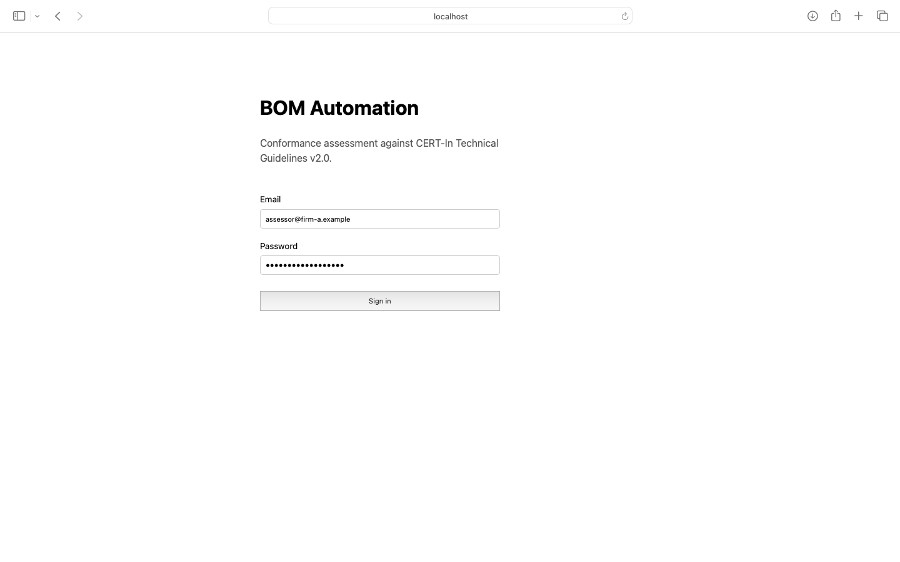
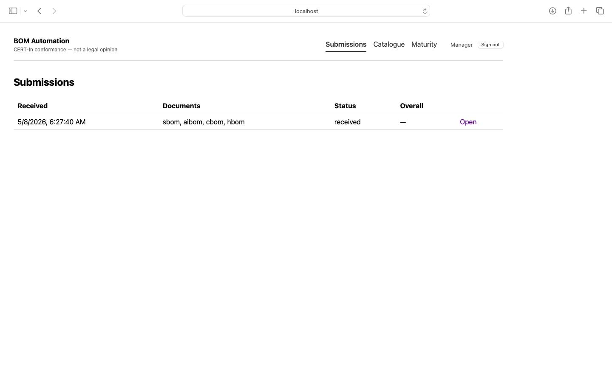
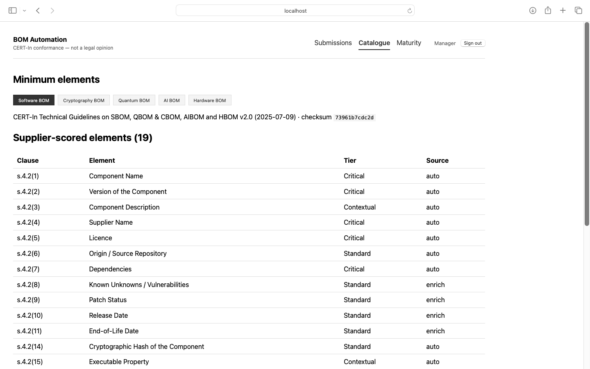
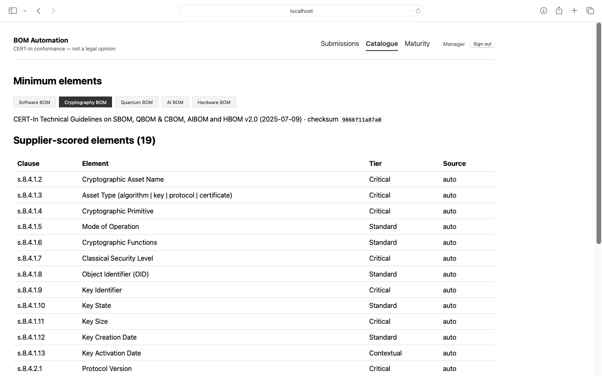
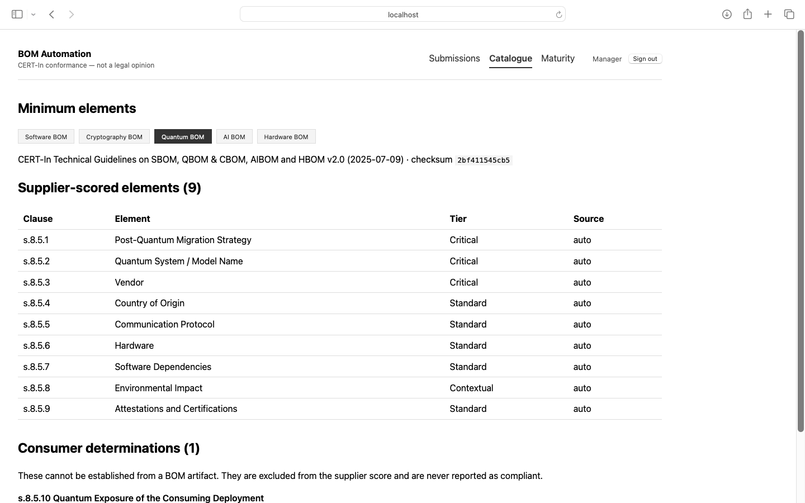
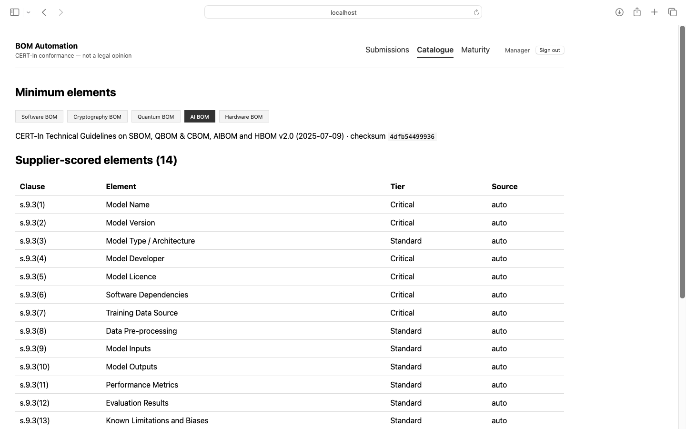
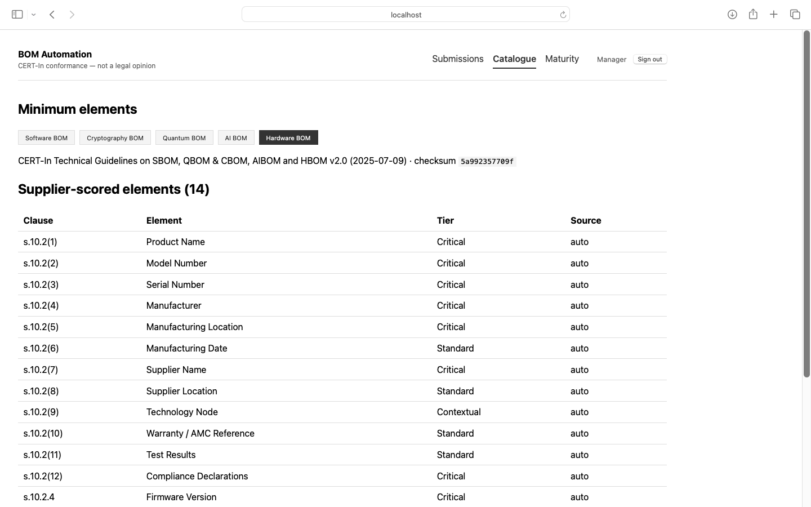
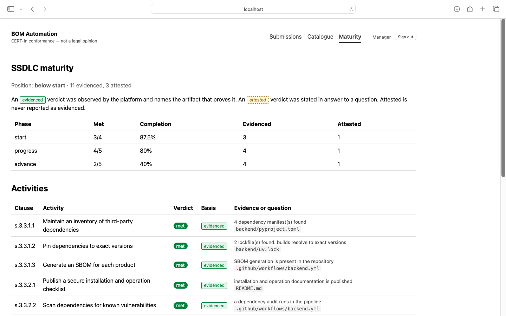
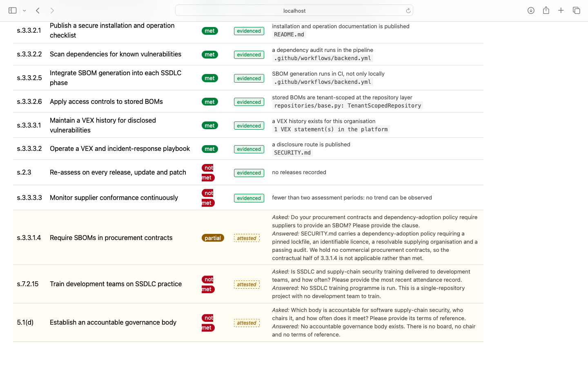

# The console, running

Captured from `make demo` — SQLite, no Docker, real cdxgen output. Every figure and
clause reference on these screens came from the scoring engine and the encoded
catalogue; none of it is mock data or a design comp.

Reproduce with:

```bash
make demo   # then sign in as assessor@firm-a.example / demo-password-1234
```

---

## Sign in



MFA is on by default in production and off in the demo (`MFA_REQUIRED=false`).
A correct password on a real deployment yields a five-minute `mfa_pending` token
that can read nothing — the MFA challenge returns **200**, not a 4xx, because the
password was right and the caller simply has more to do.

The strapline is not decoration: **"CERT-In conformance — not a legal opinion."**
This product measures conformance of a declaration against the guideline's minimum
elements. Certification is a regulatory act and compliance is a legal one, and
neither is on offer here.

---

## Submissions



The seeded submission carries four documents — `sbom, aibom, cbom, hbom`. Two
details in this table are deliberate:

**Overall shows an em dash, not `0%`.** The submission is `received` and unscored.
An unscored submission and a zero-scoring one look completely different to a
reader, and only one of them is a catastrophe — so null never renders as a number.

**QBOM is absent from the document list on purpose.** The engagement's
`enabled_lanes` omits it, so that lane reports `lane_not_applicable` and is
excluded from the overall score. A client with no quantum hardware has nothing to
declare; a client running cryptography with no CBOM has *failed* to declare it.
Those are different findings and the schema keeps them apart.

---

## The encoded catalogue

All five CERT-In tables are encoded and readable through the console, so a client
can check them against the published PDF rather than trusting them. Each lane
carries its own checksum.

### SBOM — s.4.2



19 supplier-scored elements of 21. The two missing from this list are s.4.2(12)
Criticality and s.4.2(13) Usage Restrictions, which appear in their own
**Consumer determinations** section further down the page.

The `Source` column is the accountability question: `auto` means the field is
readable from the artifact, so an absence is the supplier's; `enrich` means it is
resolvable from an external feed (NVD, KEV, endoflife.date), so a feed outage is
reported distinctly from a supplier gap.

### CBOM — s.8.4



Table 8/9's four asset types, keyed by clause: algorithms (s.8.4.1.2–13), protocols
(s.8.4.2.x), certificates (s.8.4.3.x). Scope matters here in a way it does not for
SBOM — a classical security level is meaningful for an algorithm and meaningless
for a certificate, so out-of-scope assets leave the **denominator** rather than
counting as absent.

### QBOM — s.8.5



s.8.5.1 Post-Quantum Migration Strategy leads the table, matching the guideline's
own order. It was previously declared fourth — a real defect the S20 catalogue
audit found once the ordering check became notation-aware, and one that had gone
unnoticed because ordering was only ever checked for the two lanes whose clause
notation the old check understood.

s.8.5.10 Quantum Exposure of the Consuming Deployment is visible at the bottom as
the single consumer determination, with the line that governs the whole concept:
*"These cannot be established from a BOM artifact. They are excluded from the
supplier score and are never reported as compliant."*

### AIBOM — s.9.3



14 supplier-scored of 16. s.9.3(15) Intended Usage and s.9.3(16) Out-of-Scope Usage
are governance declarations by the consuming organisation — the AIBOM counterparts
of s.4.2(12)–(13).

### HBOM — s.10.2



Table 11. Note the last two rows: **`s.10.2.4` Firmware Version sits beside
`s.10.2(12)`**, and those are genuinely different clauses of the guideline that
differ by one character — `10.2(4)` is Manufacturer, a row of the Table 11 ordinal
list, while `s.10.2.4` is the section making the HBOM-with-SBOM pairing explicit.
Both are correct. The `s.` prefix on section references exists so a reader cannot
mistake one for a typo of the other; the catalogue audit found this and it is
fixed at the point of rendering rather than by renumbering the guideline.

HBOM data is also **procurement data** — manufacturer location, warranty, test
results come from asset registers and purchase records, not from a scanner — and
the assessment says which claims rest on a scan and which on a purchase order.

---

## SSDLC maturity — our own scorecard



This is **BOM Automation assessing itself** against s.3.3, published whatever it
says: *below start*, 11 evidenced, 3 attested. A firm that assessed clients while
hiding its own scorecard would deserve the obvious question.

The legend states the rule the whole page is built on: *"An **evidenced** verdict
was observed by the platform and names the artifact that proves it. An **attested**
verdict was stated in answer to a question. Attested is never reported as
evidenced."*

## Attested is never evidenced



The distinction made visible. The evidenced rows above name a real file —
`backend/uv.lock`, `.github/workflows/backend.yml`, `SECURITY.md`,
`repositories/base.py: TenantScopedRepository`. A verdict claiming evidence
without an artifact reference **cannot be constructed**; the dataclass refuses it.

The three shaded rows at the bottom are attested, and they look different on
purpose — dashed border, italics, tinted row. Three of the fourteen s.3.3
activities cannot be observed from any artifact, so each carries the *question*
that was asked and the *answer* given:

- **s.3.3.1.4** — `partial`, not `met`: *"We hold no commercial procurement
  contracts, so the contractual half of 3.3.1.4 is not applicable rather than
  met."* The honest verdict, not the flattering one.
- **s.7.2.15** — `not met`: *"This is a single-repository project with no
  development team to train."*
- **s.5.1(d)** — `not met`: *"No accountable governance body exists. There is no
  board, no chair and no terms of reference."*

A scorecard where a client's word and a checked artifact render identically invites
a client to trust the wrong half. That is why the styling differs, and it is the
same discipline as `not_determinable` never rendering as compliant.

---

*See [PRODUCT_SPECIFICATION.md](PRODUCT_SPECIFICATION.md) for what each screen is
for, and [COMPLIANCE_MATRIX.md](COMPLIANCE_MATRIX.md) for the clause-by-clause
mapping behind the catalogue pages.*
